# ProximalBase.jl 0.7 documentation redesign: audit and proposal

Design material for [#1212](https://github.com/mlakolar/ProximalBase.jl/issues/1212), stage G0.
It is outside the published manual and changes no page of it. The audited
revision is `32b9373c5e757e623896c8833516d581d895e13a` on `master`.

## In one page

**What is wrong today.** The manual is accurate, complete and executable, but it is
organized around how it was written rather than what a newcomer wants to do. There is
no installation command on Home or in the README, and nothing says that the registered
release (0.5.4) has a different interface. No table says which function supports which
operation or storage kind; the one trait table covers 21 of 30 functions, and the README
and the selection guide each cover 20. Page titles hide what they contain: "The ℓ₂ and group ℓ₂ norms" covers
seven families, losses are scattered through `smooth.md`, and constraints have no page.
The numerical-contract index, the entry point for guarantees, carries a "Migration
state" column, and 23 of the 30 family pages contain "Links only." stubs.
→ [Full audit](audit.md)

**What other libraries do that would help.** A runnable example on the front page
(ProximalOperators, CVXPY), capability tables with check marks and one-line legends,
split by what readers filter on (SciPy, Convex.jl), a blunt "is this the right
package?" statement (JuMP), a fixed order for every function entry (PyTorch,
scikit-learn), and shared figures of penalty shapes (scikit-learn, Ceres). Diátaxis is
useful as a review tool, not as four folders. → [Research](research.md)

**What is proposed.**

- **Reorganize the sidebar, not the file tree.** Six groups (Getting started, Functions,
  User guide, Examples, Reference, Developer guide). Every page keeps its path and URL;
  six pages are new. → [Architecture and page mapping](architecture.md)
- **A front door:** a Home page that says what the package is, how to install it, a
  three-line example and when to use ProximalSolvers; and a five-minute quick start
  with ordinary arrays. → [Home](prototypes/index.md), [quick start](prototypes/quickstart.md)
- **Discovery by purpose:** a catalog grouped as losses, penalties, constraints and
  building blocks, with "if your model needs… use…" rows; and capability tables of
  function × operation and function × storage, every cell backed by a test or probe.
  → [Catalog](prototypes/catalog.md), [capability tables](prototypes/capabilities.md),
  [table design](compatibility-tables.md)
- **One entry format for every function**, placed on six role pages:
  definition, constructor, example, operations, storage, "good to know", links.
  → Prototypes for [`NormL1`](prototypes/functions/norml1.md),
  [`LeastSquaresLoss`](prototypes/functions/leastsquaresloss.md),
  [`GroupNormL2`](prototypes/functions/groupnorml2.md) and
  [`IndBallL1`](prototypes/functions/indballl1.md)
- **Guarantees for users:** an index by role with a plain-language legend and a table
  of open limitations; authoring rules move to the developer guide; no guarantee
  changes. → [Guarantee overview](prototypes/guarantees.md)
- **Figures** of penalties, thresholding, group shrinkage, projections and iterate
  storage, generated with the standard library and checked against ProximalBase.
  → [Visualizations](prototypes/visualizations.md)
- **Editorial principles** for future pages. → [Principles](editorial-principles.md)
- **Ten PRs** after this one, several of them parallel. → [Roadmap](roadmap.md)

## Previews

[`preview/build_preview.jl`](preview/build_preview.jl) builds the proposed site in a
temporary directory: the current pages in the proposed navigation, with the
prototypes in place. It does not touch `docs/src`. It is how every prototype example
and link in this folder was checked.

```sh
julia --project=docs docs/design/docs-redesign-0.7/preview/build_preview.jl /tmp/pb-preview
python3 -m http.server 8000 --directory /tmp/pb-preview/build
```

| | Current | Proposed |
|:--|:--|:--|
| Home, desktop | 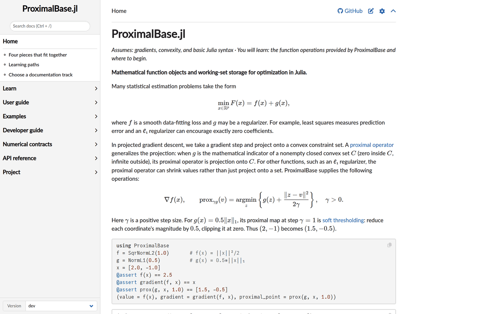 | 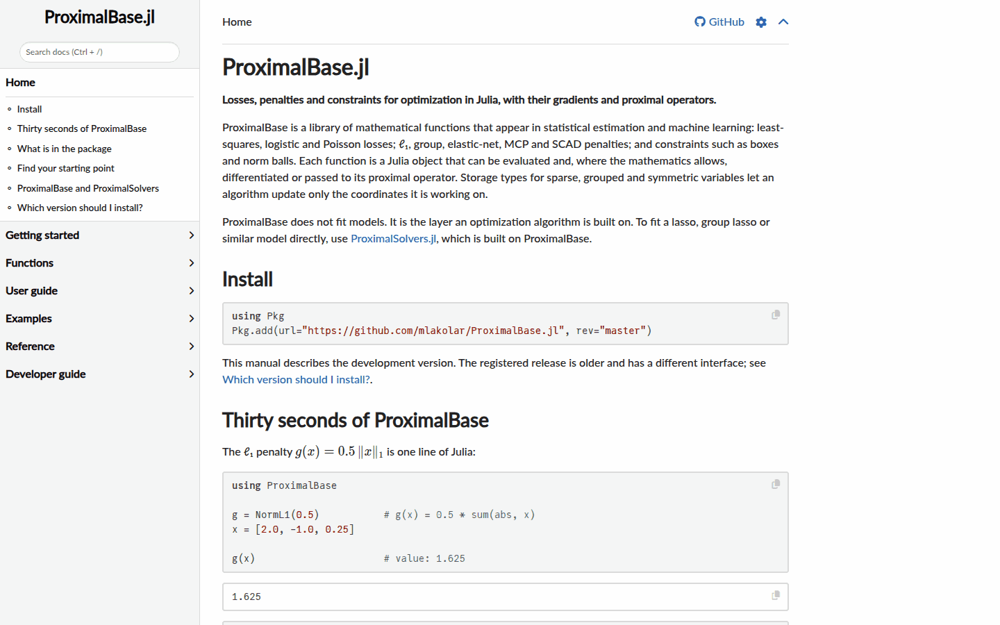 |
| Home, phone | 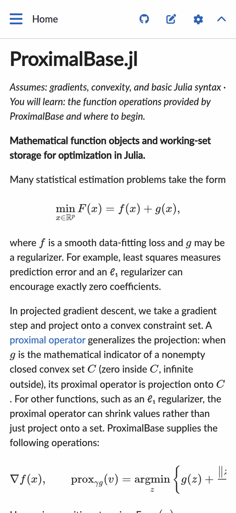 | 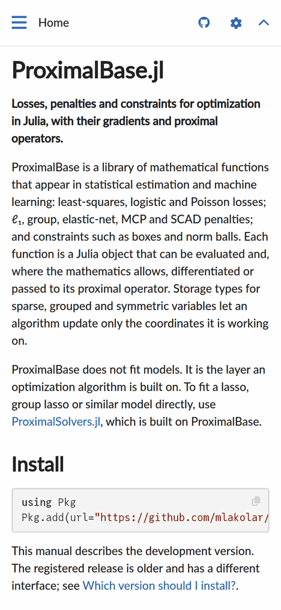 |
| Choosing a function | 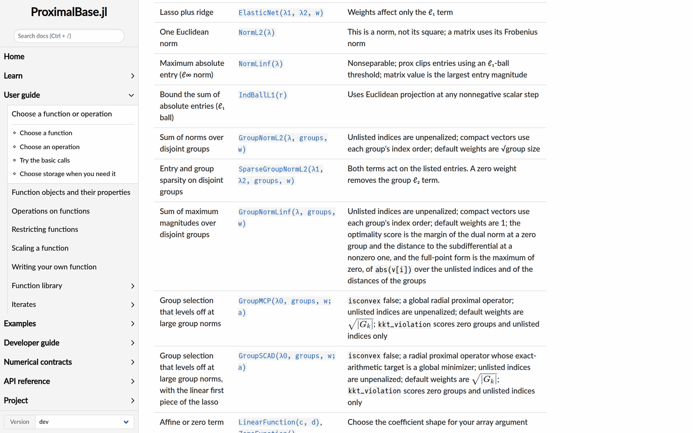 | 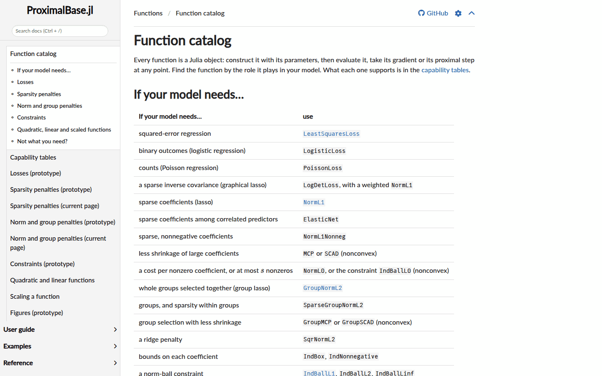 |
| Capabilities on a phone | 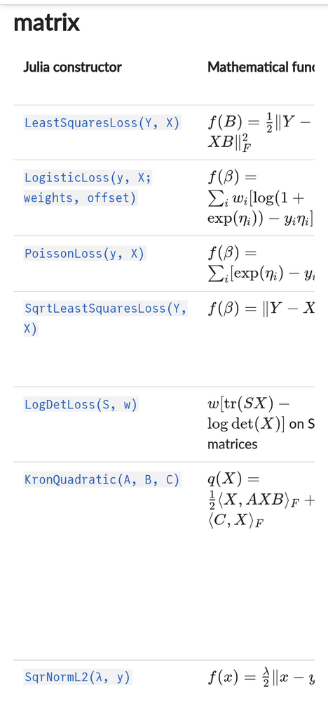 | 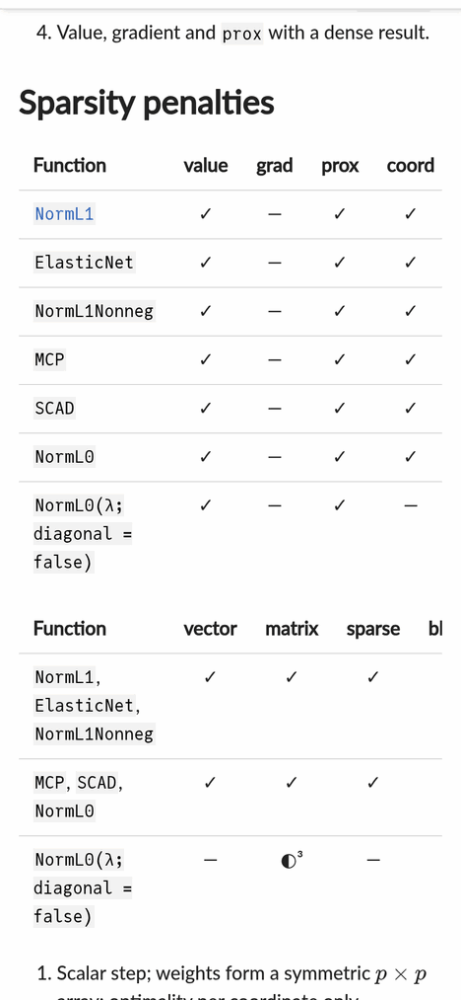 |
| Guarantees | 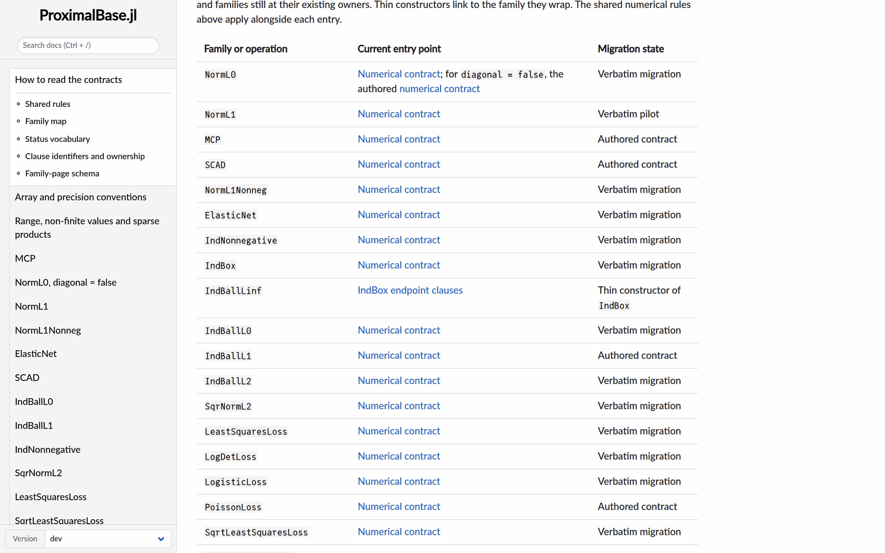 | 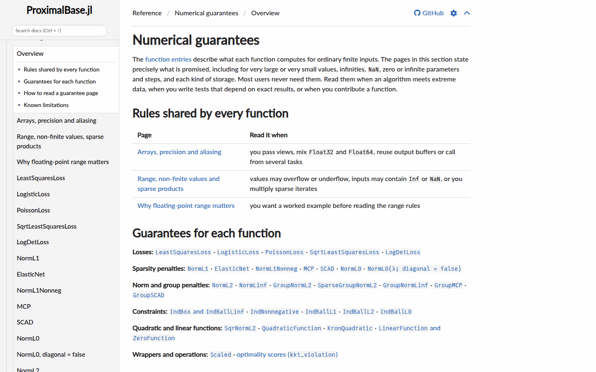 |
| A function entry | 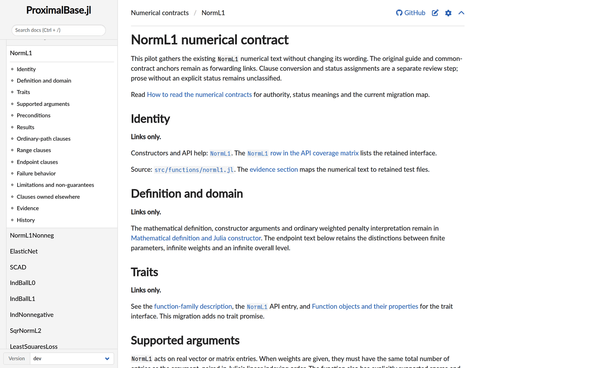 | 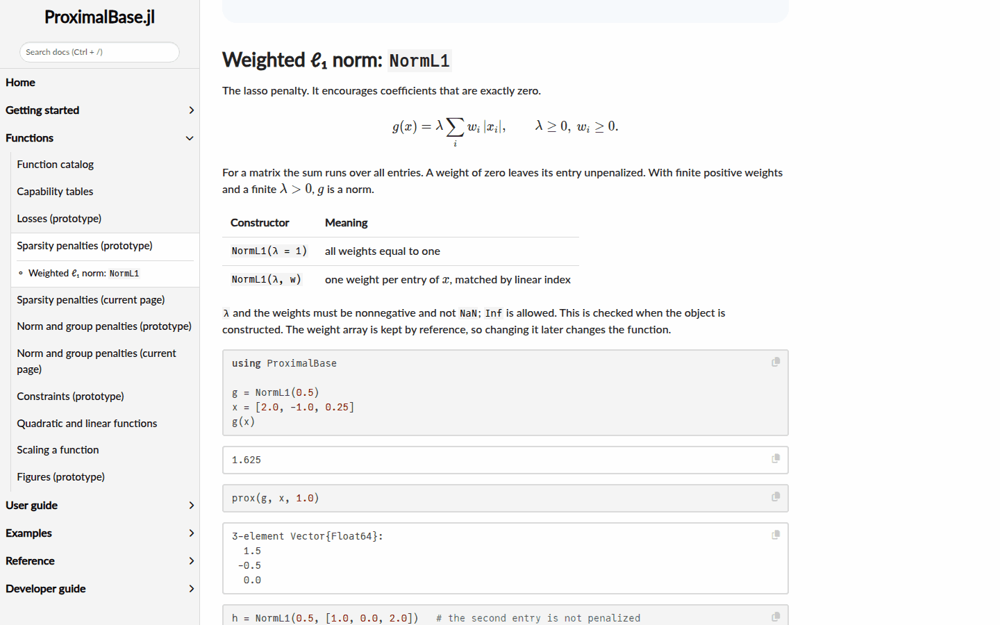 |

## How the material was produced

Independent agents did four pieces of work in parallel: external research, a review
of the documentation history and checks, a capability audit with probes on Julia
1.13.4, and a walkthrough of the rendered site. The orchestrating session
consolidated their findings, wrote the prototypes and figures, and checked every
formula and example against the implementation. **The walkthroughs were done by an
agent, not by people**; G10 of the roadmap is the independent review. Raw notes
(screenshots, crawl data, probe scripts) were not committed.

## Decisions for the maintainer

Each decision has a recommendation; the proposal is written as if the
recommendations were accepted.

1. **Grouped role pages or one page per function?** *Recommended: grouped pages*
   (six pages, with entries as sections), as #1212 asks to prefer existing pages.
   One page per function gives each function its own URL and search hit, but adds
   about 30 sidebar entries and splits comparisons.
2. **Where do the numerical guarantees sit?** *Recommended: under Reference*, collapsed,
   giving six groups. The alternative is a seventh top-level group, which keeps
   today's prominence for reader C but puts expert material in the newcomer's sidebar.
3. **What does Home tell people to install before 0.7 is registered?** *Recommended:*
   the `master` URL with a version table (development, 0.6 when released, 0.5.4), updated
   at each release. Whether `stable` should move to 0.6 once it is tagged is part of
   #1204's separation of development and release documentation.
4. **Empty sections on guarantee pages.** 23 pages contain "Links only." sections because
   the fourteen-heading schema is enforced. *Recommended:* keep the schema and the stable
   section anchors, but replace each "Links only." marker with a one-line pointer
   ("The definition is in the [`NormL1` entry](…)"). The alternative, allowing a page to
   omit empty sections, changes `check_contract_schema.py` and the #1019 schema, and
   anchors that point to omitted sections would need forwarding.
5. **Statement statuses.** *Recommended:* keep showing them, with the plain-language
   legend of the [guarantee prototype](prototypes/guarantees.md), since they matter to
   reader C and 34 non-guarantees and 17 characterized statements already use them.
6. **How the capability tables stay correct.** *Recommended:* hand-written, with the
   supporting test or probe for each cell recorded in the developer coverage matrix, and
   a checklist item in the family-change process. A test that derives cells from method
   tables would contradict #1212's rule that methods and traits are not proof of support.
7. **A "Common pitfalls" page.** *Recommended: yes* (G8), each entry linking to the owning
   rule. The alternative is to rely on the "good to know" lists of the function entries.
8. **Runtime usability findings** (the display of function objects, the `MethodError` from
   `gradient` on a nonsmooth function). *Recommended:* separate 0.7 issues, outside this
   project, filed if you agree.
9. **Figure tooling.** *Recommended:* fold the prototype generator into
   `docs/generate_learn_figures.py` (G8) and add its `--check` to the documentation job.
   This keeps the figures dependency-free; Plots.jl or Makie in the docs environment
   would make them easier to restyle but heavier to build.

## Files

| File | Contents |
|:--|:--|
| [audit.md](audit.md) | current state, reader walkthroughs, drift, constraints, separately recorded defects |
| [research.md](research.md) | external documentation research |
| [architecture.md](architecture.md) | proposed navigation, page mapping, link preservation |
| [compatibility-tables.md](compatibility-tables.md) | design of the capability tables |
| [editorial-principles.md](editorial-principles.md) | principles and the function-entry template |
| [roadmap.md](roadmap.md) | the implementation PRs |
| [prototypes/](prototypes/) | Home, quick start, catalog, capability tables, four function entries, guarantee overview, figures |
| [figures/](figures/) | figure generator, its Julia check and the SVGs |
| [preview/](preview/) | the preview build script |
| [screenshots/](screenshots/) | current site and preview screenshots |
