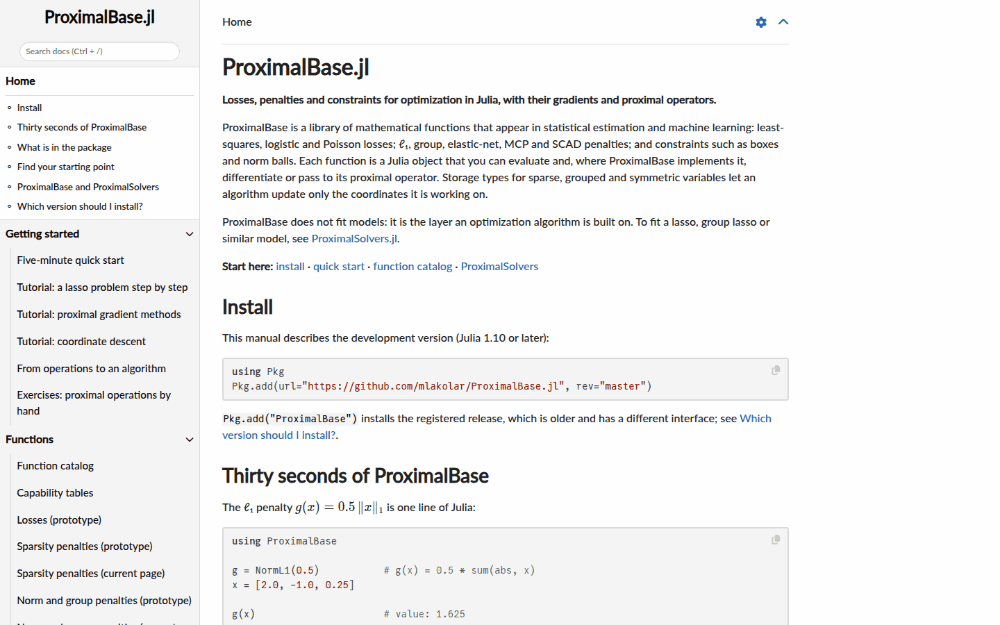

# Proposed information architecture

## The central idea: reorganize the sidebar, not the file tree

In Documenter a page's place in the sidebar is set in `docs/make.jl` and does not
depend on its file path. Most of the redesign can therefore be done by changing the
navigation, rewriting a few entry pages and adding five new ones (four for users, one
for contributors), while **every existing page keeps its path and therefore its public
URL**. Where a section moves to another page, its old heading stays behind as a
forwarding heading with the old anchor, as the manual already does
(`penalties.md#l1-endpoints` is an example).

This avoids the expensive part of a reorganization: about 420 relative
`page.md#Heading` links inside the manual, about 50 anchors that `src/` docstrings
reference with `@ref`, and links from the README, `AGENTS.md`, `CONTRIBUTING.md` and
test and benchmark comments (see the [audit](audit.md#constraints-a-redesign-must-respect)).

## Proposed navigation

Six groups after Home instead of seven, at most three levels deep, in reading order.
**New** marks a new page; every other entry is an existing file at its current path.
Sidebar labels and page headings are made the same.

```text
Home                                         index.md            rewrite
Getting started
  Five-minute quick start                    quickstart.md       New
  Tutorial: a lasso problem step by step     getting_started.md
  Tutorial: proximal gradient methods        proximal_gradient.md
  Tutorial: coordinate descent               coordinate_descent.md
  From operations to an algorithm            optimization_algorithms.md
  Exercises: proximal operations by hand     learn/proximal_exercises.md
Functions
  Function catalog                           function_library.md rewrite; absorbs choosing.md
  Capability tables                          capabilities.md     New
  Losses                                     smooth.md           retitled; quadratic family moved out
  Sparsity penalties                         penalties.md
  Norm and group penalties                   group_penalty.md
  Constraints                                constraints.md      New
  Quadratic and linear functions             quadratic.md        New (sections from smooth.md)
  Scaling a function                         calculus.md
User guide
  Operations on functions                    operations.md
  Function properties                        function_objects.md
  Restricting a function                     restrict.md
  Iterates and working sets                  iterates.md
  SparseIterate                              sparse_iterate.md
  BlockIterate                               block_iterate.md
  SymmetricSparseIterate                     symmetric_sparse_iterate.md
  Coordinate and block operations            iterate_oracles.md
  Symmetric parameters                       symmetric_parameters.md
  Writing your own function                  extending.md
Examples                                     examples/*.md       retitled by task
Reference
  API reference ▸ (Overview, Interface, Functions, Scaling, Iterates)   api.md, api/*.md
  Numerical guarantees ▸
    Overview                                 spec/index.md       rewrite
    Arrays, precision and aliasing           numerical_usage.md
    Range, non-finite values, sparse products numerics.md
    Why floating-point range matters         learn/floating_point.md
    LeastSquaresLoss … kkt_violation (30 pages)  spec/*.md
  Glossary                                   glossary.md
  Changes from earlier versions              migration.md
Developer guide
  Overview and package structure             developer/index.md
  System architecture                        architecture.md
  Storage internals (3 pages), views and aliasing, dispatch
  Numerical routines ▸ (11 pages)            developer/routines/*
  How the guarantee pages are written        developer/contract_pages.md New (from spec/index.md)
  Design contracts ▸ (3 pages)               developer/contracts/*
  API coverage matrix                        api/coverage.md
  Change process                             developer/change_process.md
  Writing documentation                      developer/writing_documentation.md
```



The rendered preview has 6 groups and 10 collapse controls (today 7 and 9); the 30
guarantee pages are one level deeper than today and collapsed by default, so readers A
and B see them only if they open Reference or follow a link.

### Why these groups

| Group | Diátaxis kind | Reader | Answers |
|:--|:--|:--|:--|
| Getting started | tutorials | A, B | "How do I use this at all?", "How is an algorithm built from these calls?" |
| Functions | reference, with one how-to (choosing) | A first, B | "Which function do I need?", "What does it support?" |
| User guide | how-to and explanation | B, then A | "How do operations, iterates and extensions work?" |
| Examples | tutorials and how-to | A, B | "Show me a complete small program." |
| Reference | reference | B, C | signatures, guarantees, terms, version changes |
| Developer guide | contributor material | C | internals, routines, process |

The old reader tracks (Learn, Developer guide, Numerical contracts) were organized by
*kind of content*; the new groups are organized by *what the reader is trying to do*.
To meet #1212's requirement that reader C's path not be needed for reader A's, the
first three groups are written so that they need no process material; G9 removes the
remaining process wording from the pages they link to.

### What happens to "Learn"

The Learn group disappears as a label. Its tutorials join "Getting started", the
floating-point lesson moves next to the range rules it introduces, and the glossary
joins Reference. No page is removed.

## Paths for the readers' tasks

Choices are counted from Home: a link on a page or an entry in the sidebar is one
choice. On a phone, reaching the sidebar costs one more tap on the menu; links on Home
do not. The counts follow the links in the prototypes, which the preview build
resolves.

| Task | Reader | Path in the proposal | Choices | Today |
|:--|:--|:--|--:|--:|
| What the package does; when to use ProximalSolvers | all | Home, first screen | 0 | 0, second screen |
| Install | all | Home, "Install" | 0 | 3 |
| Compute a proximal operator | A, B | Home example, or quick start | 0 or 1 | 0 |
| Find a regularizer for group sparsity | A | Home → catalog ("If your model needs…") | 1 | 3 |
| List all loss functions | A | Home → catalog, "Losses" | 1 | 4 |
| Does `NormL1` support coordinate updates, or a `BlockIterate`? | A, B | Home → capability tables | 1 | 3 + scroll, incomplete |
| Signature and conditions of `GroupNormL2` | B | Home → catalog → its API entry | 2 | 2 |
| Write a custom function | B, C | Home → "Writing your own function" | 1 | 2 |
| Guarantees and limitations of `NormL1` | C | Home → guarantees → `NormL1` | 2 | 3 |
| A numerical routine | C | Home → developer guide → routines → page | 3 | 3 |

"Common destinations within two choices", the target of #1212 G3, holds for every
row except the routine pages, which are contributor material.

## Function entries: grouped pages, not one page per function

Every public function gets a standardized entry (template in the
[editorial principles](editorial-principles.md#function-entries)), placed as a section
on one of six role pages:

| Page | Functions |
|:--|:--|
| Losses (`smooth.md`) | `LeastSquaresLoss`, `LogisticLoss`, `PoissonLoss`, `SqrtLeastSquaresLoss`, `LogDetLoss` |
| Sparsity penalties (`penalties.md`) | `NormL1`, `ElasticNet`, `NormL1Nonneg`, `MCP`, `SCAD`, `NormL0` and `NormL0(λ; diagonal = false)` |
| Norm and group penalties (`group_penalty.md`) | `NormL2`, `NormLinf`, `GroupNormL2`, `SparseGroupNormL2`, `GroupNormLinf`, `GroupMCP`, `GroupSCAD` |
| Constraints (`constraints.md`, new) | `IndBox`, `IndBallLinf`, `IndNonnegative`, `IndBallL1`, `IndBallL2`, `IndBallL0` |
| Quadratic and linear functions (`quadratic.md`, new) | `SqrNormL2`, `QuadraticFunction`, `KronQuadratic`, `LinearFunction`, `ZeroFunction` |
| Scaling a function (`calculus.md`) | `Scaled` |

That is 30 function types and 31 entries, since the two forms of `NormL0` get
separate entries. Why grouped pages: #1212 asks to prefer existing pages over
per-function pages; related functions are compared on one page (lasso, elastic net and
MCP); the sidebar stays short; and most existing anchors stay where they are. The cost
is longer pages, which the entry template keeps manageable by moving edge-case material
to the guarantee pages. A per-function layout is the alternative listed in the
[decisions](README.md#decisions-for-the-maintainer).

Today the constraints have no user page: the catalog links four of the six to the
general numerical contract page, one to its API entry and one to its guarantee page.
Losses share `smooth.md` (about 6,300 words of Markdown source) with the quadratic
utilities, and `LogisticLoss` and `PoissonLoss` are its last two sections. The losses
stay on `smooth.md`, whose loss sections carry the most-cited anchors, and the
quadratic family moves to a new page.

## Mapping from existing pages

Actions: **retain** (content unchanged apart from links), **retitle** (sidebar label
and heading), **rewrite** (same path and anchors, new content), **split** (part moves to
another page, forwarding headings left behind), **consolidate** (content moves into
another page, the old path stays as a hidden forwarding page), **relocate** (new
sidebar position only), **new**. No existing page is removed.

### User pages

| Current page (sidebar title) | Action | Destination | Notes |
|:--|:--|:--|:--|
| `index.md` Home | rewrite | Home | [Prototype](prototypes/index.md). The anchors `Where-to-start` and `documentation-tracks` move to the corresponding new sections; the subdifferential paragraph moves to the tutorials and the glossary |
| `getting_started.md` A first lasso problem | retitle, trim | Getting started | Install section replaced by a link to the version table on Home |
| `proximal_gradient.md`, `coordinate_descent.md`, `learn/proximal_exercises.md` | relocate, retitle | Getting started | — |
| `optimization_algorithms.md` What a solver adds | retitle, relocate | Getting started | The ProximalSolvers comparison moves to Home |
| `learn/floating_point.md` | relocate | Reference ▸ Numerical guarantees | Next to `numerics.md`, which it introduces |
| `glossary.md` | relocate | Reference | Gains "oracle", "active zero" and "compact block" |
| `choosing.md` Choose a function or operation | consolidate | Function catalog (functions), operations guide (operations table) | Kept as a hidden forwarding page that keeps `@id choosing` |
| `function_objects.md` | retain, trim | User guide ▸ Function properties | The built-in trait table (21 of 30 functions) is replaced by a link to the capability tables |
| `operations.md` | retain | User guide | Gains the "choose an operation" table of `choosing.md` |
| `restrict.md`, `extending.md` | relocate | User guide | — |
| `calculus.md` Scaling a function | relocate | Functions | Gains a standardized `Scaled` entry |
| `function_library.md` Browse available functions | rewrite | Function catalog | [Prototype](prototypes/catalog.md) |
| `smooth.md` Smooth array functions | split, retitle | Losses | The `SqrNormL2`, `QuadraticFunction`, `KronQuadratic`, `ZeroFunction`, `LinearFunction` and stationarity-score sections move to `quadratic.md` under new anchors; their old headings and anchors stay as forwarding headings |
| `penalties.md` The ℓ₁ norm and soft thresholding | rewrite in place, retitle | Sparsity penalties | [NormL1 prototype](prototypes/functions/norml1.md) |
| `group_penalty.md` The ℓ₂ and group ℓ₂ norms | rewrite in place, retitle | Norm and group penalties | [GroupNormL2 prototype](prototypes/functions/groupnorml2.md) |
| iterate pages (`iterates.md`, `sparse_iterate.md`, `block_iterate.md`, `symmetric_sparse_iterate.md`, `iterate_oracles.md`, `symmetric_parameters.md`) | relocate | User guide | Each links to the capability tables instead of repeating them |
| `numerical_usage.md` | relocate, retitle | Reference ▸ Numerical guarantees | Its ownership table is rewritten in plain language (G9) |
| `numerics.md` | relocate | Reference ▸ Numerical guarantees | Path and section titles unchanged: 34 source and test comments cite them |
| `migration.md` Compatibility and migration | relocate, retitle | Reference ▸ Changes from earlier versions | — |
| `interface.md`, `storage.md` (hidden) | retain | hidden | Existing forwarding pages |
| — | new | `quickstart.md`, `capabilities.md`, `quadratic.md`, `constraints.md` | — |

### Examples

The nine Literate pages keep their paths. Titles change to say what each example does:

| File | Current title | Proposed title |
|:--|:--|:--|
| `lasso` | Least-squares and lasso primitives | Evaluate a lasso objective and its proximal step |
| `proximal_gradient` | Proximal-gradient iteration | Write a proximal-gradient loop |
| `coordinate_operations` | Coordinate-level operations | Update one coordinate at a time |
| `sparse_working_sets` | Sparse working sets | Keep a working set with `SparseIterate` |
| `block_storage` | Ordered grouped storage | Store groups of coefficients with `BlockIterate` |
| `symmetric_storage` | Independent symmetric coordinates | Work with a symmetric matrix variable |
| `group_lasso_prox` | Group-lasso proximal building blocks | Take group-lasso proximal steps |
| `custom_function` | A custom separable function | Write a separable function |
| `block_prox_extension` | A compact-vector block extension | Add a block proximal operator to your function |

### Reference, guarantees and developer pages

| Current page | Action | Destination |
|:--|:--|:--|
| `api.md`, `api/interface.md`, `api/functions.md`, `api/calculus.md`, `api/iterates.md` | relocate | Reference ▸ API reference |
| `api/coverage.md` | relocate | Developer guide (it maps symbols to tests, a maintainer view) |
| `spec/index.md` How to read the contracts | split, rewrite | The user half stays at this path, with its anchor `numerical-contracts-guide`, as the [guarantee overview](prototypes/guarantees.md), including a checked family map without the migration column. The authoring rules move to a new `developer/contract_pages.md` with new anchors; the cited heading "Family-page schema" stays as a forwarding heading |
| 30 `spec/<family>.md` | relocate | Reference ▸ Numerical guarantees (collapsed). Process wording ("This pilot gathers…", "verbatim", "Links only.") is reworded in G9 without changing any rule |
| `developer/contracts/*` (generated from `docs/design/`) | relocate | Developer guide |
| `developer/index.md`, `architecture.md`, `developer/*.md`, `developer/routines/*.md` | retain | Developer guide |
| `developer/change_process.md`, `developer/writing_documentation.md` | relocate | Developer guide (from "Project") |

## Preserving links and anchors

The rules are the existing ones in `developer/writing_documentation.md`; nothing new
is introduced.

1. **Page URLs.** No page path changes, so every `/dev/<page>/` URL keeps working. A
   consolidated page (`choosing.md`) stays as a hidden forwarding page, like
   `interface.md` and `storage.md`, and is added to the hidden-page list in
   `docs/check_html.py`.
2. **Explicit anchors** (`@id`) stay where they are. When a section moves, its old
   heading stays as a forwarding heading with the old anchor, and the moved section
   gets a new anchor; links inside the manual and in `src/` docstrings are pointed at
   the new anchor in the same PR where useful. The strict build fails if an explicit
   anchor that is referenced disappears.
3. **Automatic heading anchors** that are cited (from the manual, docstrings, README,
   `AGENTS.md`, `CONTRIBUTING.md`, examples or source comments) get a forwarding
   heading on the old page when their section moves or is renamed. Uncited ones may
   retire with a checked successor, as #1198 did. Page headings (H1) that are retitled
   lose their automatic anchor; none of the affected H1 anchors is cited today.
4. **Every PR that moves a section** lists each old page and fragment and its forwarding
   target or the evidence that it was not cited, and checks them against the built site.
   For the prototypes this was done by comparing every anchor of the live `dev` site with
   the preview build: apart from sidebar menu ids, the only anchors that disappear are the
   automatic heading anchors below, none of which is cited in the manual, the docstrings,
   the repository's Markdown files, the examples, the tests or the scripts.

   | Page | Retired automatic anchors | Successor |
   |:--|:--|:--|
   | `index.md` | `Four-pieces-that-fit-together` | "What is in the package" (`documentation-tracks`) |
   | `choosing.md` | `Choose-a-function`, `Choose-an-operation`, `Try-the-basic-calls`, `Choose-storage-when-you-need-it` | the catalog, the operations guide, the quick start, the iterate overview |
   | `function_library.md` | `Browse-available-functions`, `Functions-of-a-vector-or-matrix`, `Combining-functions`, the "Which squared-loss object" note | the catalog's role sections and its paragraph on combining functions |
   | `spec/index.md` | `Shared-rules`, `Family-map`, `Status-vocabulary`, `Clause-identifiers-and-ownership` | "Rules that apply across functions", "Guarantees for each function", "How to read a guarantee page", and the developer page |

   Each also has a `-1` variant on the live page, which Documenter generates alongside it.
5. **External links.** Only the `/dev/` root is known to be linked from ProximalSolvers.
   `/stable/` is the frozen 0.5.4 manual and is not touched.
6. **Checks that change with the navigation**, in the PR that changes it:
   `docs/make.jl` (pages) and `docs/check_html.py` (`EXPECTED_CATEGORIES`,
   `EXPECTED_COLLAPSE_CONTROLS` and the hidden pages). The prototype Home already
   satisfies the existing check that Home has two math elements. G9 also changes
   `docs/check_contract_schema.py`, which parses the family-map table. Editing a check
   makes a PR non-docs-only, so it runs the full test lanes.
