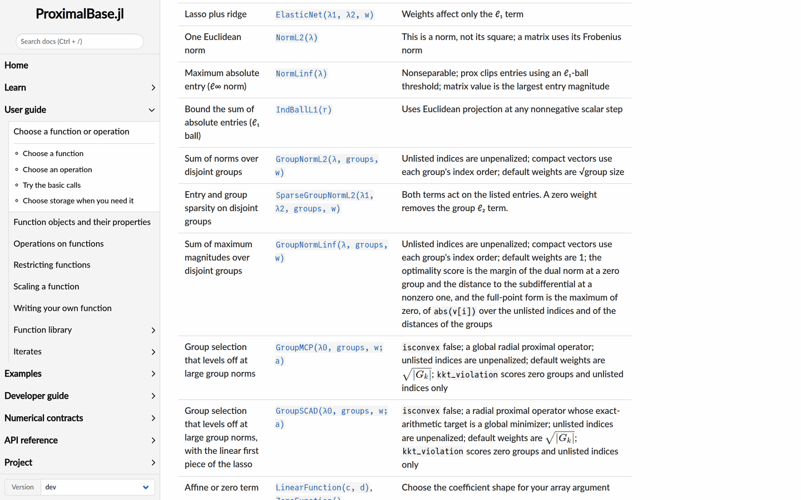
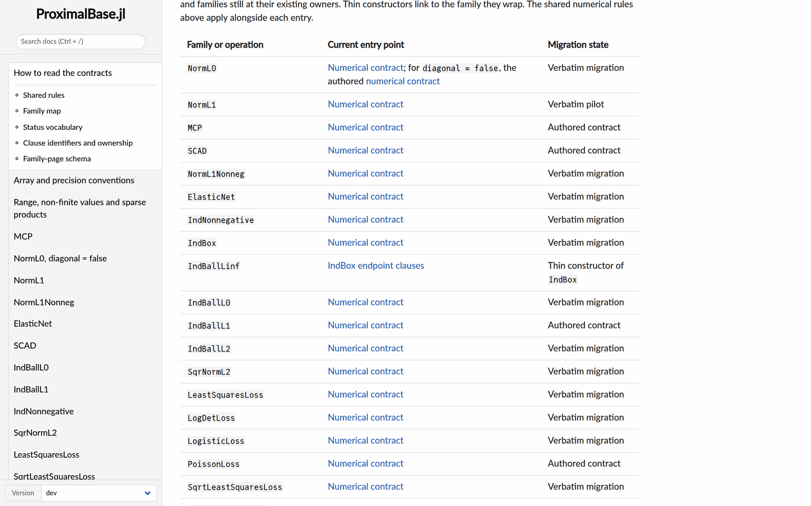
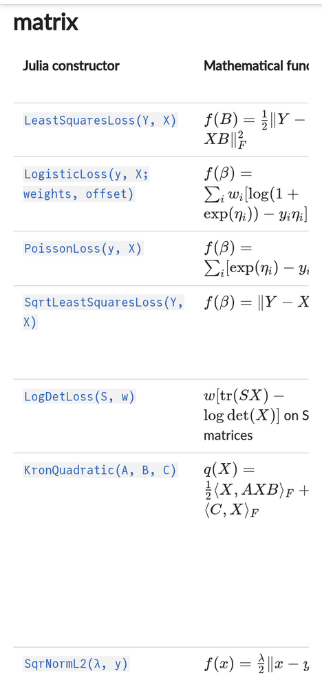

# Current-state audit

## What was audited, and how

- **Revision:** `32b9373c5e757e623896c8833516d581d895e13a` (`master`, 2026-11-24). The
  published [`dev` manual](https://mlakolar.github.io/ProximalBase.jl/dev/) was built
  from this same commit (the `gh-pages` commit message reads "build based on 32b9373c5"),
  so source and rendered site agree. `stable` serves v0.5.4.
- **Sources read:** README, every page under `docs/src`, the nine Literate examples,
  the docstrings of the pilot functions, `docs/make.jl` and the documentation checks.
  The history behind the current organization (#851, #921, #1019, #366, #1204, #1212)
  is summarized [below](#why-the-manual-looks-the-way-it-does).
- **Rendered site:** every page was crawled (98 pages, including the two hidden ones),
  links and fragments were checked, and screenshots were taken at 1440 × 900 (desktop)
  and 390 × 844 (phone) in Chrome.
- **Capabilities:** each exported function type was probed on Julia 1.13.4 for its
  operations and storage kinds. Results were checked against independent formulas and
  mapped to the tests that exercise them ([capability audit](#capability-information-and-drift)).

**All reader walkthroughs here were done by an agent following the tasks, not by
people.** They show where the path is long or where information is missing. They do
not measure how long a person takes or what a person finds confusing. The
independent usability review in the [roadmap](roadmap.md) (G10) is meant to fill that gap.

## The manual at a glance

| | |
|:--|:--|
| Sidebar | 7 groups after Home, 3 levels, 96 page entries; expanded, about 4.8 screens tall |
| Largest group | "Numerical contracts", 36 of the 96 entries |
| Size | about 109,000 words of Markdown source in `docs/src` (`wc -w`), excluding the generated example and contract pages |
| Longest user pages (source words) | `group_penalty.md` 6,762 (18 screens rendered), `smooth.md` 6,323 (17), `operations.md` 3,674 (14) |
| Anchors | 580 explicit `(@id …)` anchors in `docs/src` |
| Links | 1,095 distinct internal targets checked, with no broken link or missing fragment; 470 external links answered HTTP 200 (line-range anchors of GitHub links not checked) |
| Examples | 9 Literate examples, all executed by the strict build |

Its examples run, its internal links resolve and its API reference covers every
export. Its main problems are **order, emphasis and discoverability**, together with
some stale or incomplete lists (findings 2 and 3).

## Main findings

Severity is for a first-time user.

| # | Finding | Severity | Where |
|:--|:--|:--|:--|
| 1 | **No installation on Home or in the README.** The only install command is on the second Learn page and installs `master`. Nothing says that the registered version is 0.5.4 with a different interface, and the site root redirects to `stable` (0.5.4) | high | [Home](https://mlakolar.github.io/ProximalBase.jl/dev/), [Getting started](https://mlakolar.github.io/ProximalBase.jl/dev/getting_started/#Installation) |
| 2 | **No capability table.** The only function × property table (`function_objects.md`) lists 21 of 30 functions; its "Proximable" column says whether a prox exists, but there is no column for coordinate or group operations or for storage kinds. Which function works with which iterate is spread over the guide and guarantee pages | high | [Function objects](https://mlakolar.github.io/ProximalBase.jl/dev/function_objects/#Properties-of-the-built-in-functions) |
| 3 | **Function lists disagree.** The README, the selection guide and the trait table each list a different subset of the 30 functions, and docstrings list only some of the functions that implement an operation; the catalog, the API reference and the contract map are complete (see [drift](#capability-information-and-drift)) | high | README, `choosing.md`, `function_objects.md`, docstrings |
| 4 | **Page titles hide their contents.** "The ℓ₂ and group ℓ₂ norms" covers seven functions; "The ℓ₁ norm and soft thresholding" covers `NormL1` and five others. Losses share `smooth.md` with quadratic utilities, and `LogisticLoss` and `PoissonLoss` are its last two sections. Constraints have no page | high | [group penalties](https://mlakolar.github.io/ProximalBase.jl/dev/group_penalty/), [smooth](https://mlakolar.github.io/ProximalBase.jl/dev/smooth/) |
| 5 | **The guarantee index is a maintainer document.** Its table has a "Migration state" column ("Verbatim pilot", "Authored contract"), and the family pages open with "This pilot gathers…". 23 of 30 contain "Links only." stubs (206 in total) | high | [contract index](https://mlakolar.github.io/ProximalBase.jl/dev/spec/), [NormL1](https://mlakolar.github.io/ProximalBase.jl/dev/spec/norml1/) |
| 6 | **README links open Markdown source on GitHub**, where `@ref` links and `@example` blocks show as raw text | high | [README](https://github.com/mlakolar/ProximalBase.jl#readme) |
| 7 | **Table cells hold paragraphs.** In the selection guide the `GroupNormLinf` cell is about 80 words; catalog cells carry storage preconditions. On a phone the catalog table is 2.3 times the screen width | medium | [choosing](https://mlakolar.github.io/ProximalBase.jl/dev/choosing/), [catalog](https://mlakolar.github.io/ProximalBase.jl/dev/function_library/) |
| 8 | **When to use ProximalSolvers is not said.** `optimization_algorithms.md` explains the division of labor (the solver chooses steps, order, caches and stopping), but no page says when to switch, how to install ProximalSolvers or which versions work together | medium | [Home](https://mlakolar.github.io/ProximalBase.jl/dev/), [What a solver adds](https://mlakolar.github.io/ProximalBase.jl/dev/optimization_algorithms/) |
| 9 | **Home opens with theory.** The first screen is a banner listing prerequisites, the composite model, the prox definition and a subdifferential paragraph; "does not provide a `solve()` function" is on the second screen | medium | [Home](https://mlakolar.github.io/ProximalBase.jl/dev/) |
| 10 | **Terms before definitions.** "Working-set storage" is in the Home tagline; "oracle" is used on 60 pages but is not in the glossary; "active zeros", "compact vector" and "clause" appear in the selection guide or user guides before any definition | medium | [term scan](#terminology) |
| 11 | **Issue history in user pages.** 113 issue references on 27 pages; `migration.md` reads as a PR ledger | medium | e.g. [migration](https://mlakolar.github.io/ProximalBase.jl/dev/migration/) |
| 12 | **Search favors expert pages.** "logistic" returns the migration page first and the contract stub third; "group" returns API entries and an example subsection before the catalog | medium | [search](#search) |
| 13 | **Sidebar labels and headings differ** on 59 of 95 pages, sometimes materially: the sidebar's "A first lasso problem" is titled "Getting started"; "Overview and package structure" is titled "Developer Documentation"; six catalog links labelled "Numerical contract" lead to two different pages | low | sidebar |

### What already works

- Home has a runnable proximal-operator example with no clicks needed.
- The "Write an optimization algorithm" reading path on Home is clear, and the Learn
  pages are short, each with a worked example.
- "Writing your own function" opens with a table of the hooks to implement.
- Every checked internal link and fragment resolves, and every example runs in the strict build.
- The search finds the install section on the first try.

## Reader walkthroughs

### Ten tasks from the Home page

"Steps" counts navigation actions from Home (opening a sidebar group or following a link).

| Task | Path today | Steps | Result |
|:--|:--|:--|:--|
| 1. What does ProximalBase do? | Home | 0 | Partly: the scope statement is on the second screen |
| 2. Install it | Learn ▸ A first lasso problem ▸ Installation, or search "install" | 3 (search 2) | `master` only; version situation unexplained |
| 3. Compute a proximal operator | Home example | 0 | Yes |
| 4. Regularizer for group sparsity | User guide ▸ Choose a function, then `group_penalty.md`, third family | 3 to the row, 5 to details | Found, but "group lasso" does not appear in the selection table |
| 4b. A nonconvex sparse penalty | Choose a function ▸ "MCP or SCAD" row, then `penalties.md`, sections 8–9 | 3 | Found; no guidance on ℓ₁ vs MCP vs SCAD |
| 5. All loss functions | User guide ▸ Function library ▸ Browse | 4 | Partly: 32 rows with no "Losses" heading; three losses missing from the selection guide |
| 6. Does NormL1 / GroupNormL2 / LogisticLoss support gradients, prox, coordinates? | User guide ▸ Function objects ▸ trait table | 3 + scroll | `LogisticLoss` absent; "separable: no" for `GroupNormL2` hides that group updates exist |
| 7. Which storage kinds does a function accept? | Each family's guarantee page, "Supported arguments" | 4–6 per function | No overview anywhere |
| 8. When to use ProximalSolvers | Home paragraph 5 ▸ What a solver adds | 2 | The division of labor is clear; when to switch and version compatibility are not |
| 9. Write a custom function | User guide ▸ Writing your own function | 2 | Yes |
| 10. Guarantees and limits of NormL1 | Numerical contracts (36 entries) ▸ NormL1 | 3 | First screen is process text and "Links only." stubs |

### Reader A: applied statistician

- **Should begin at** a function catalog organized by model term. **Today** the best
  starting point is "Choose a function or operation", mentioned on Home's second screen;
  the three "tracks" on Home do not include "choose a model component".
- **Meets unnecessary material:** the subdifferential paragraph and "documentation
  tracks" on Home, contract details in selection-table cells, and the migration page in
  search results.
- **Missing:** a loss / penalty / constraint grouping, the phrase "group lasso" as an
  entry point, a comparison of ℓ₁, elastic net, MCP and SCAD, and a user page for
  constraints.
- **Hard to find:** `LogisticLoss` has text on `migration.md`, `smooth.md` (section 11),
  its guarantee page and the API page, and search returns them in that order.

### Reader B: algorithm developer

- **Should begin at** a quick start, then the algorithm tutorials and the iterate
  overview. **Today** this is the best-signposted path ("Write an optimization
  algorithm" on Home).
- **Meets unnecessary material:** the composite-model and soft-thresholding primer is
  repeated on Home, Function objects, Getting started and Proximal gradient.
- **Missing:** a function × storage table; a summary of in-place and aliasing rules
  next to the operations table (it is in `numerical_usage.md`, whose ownership table has
  cells of more than 150 words); "oracle" and "compact vector" in the glossary.
- **Hard to find:** the `prox_block` / `prox_block!` contract is spread over
  `operations.md`, `iterate_oracles.md`, `group_penalty.md` and a developer routine page.

### Reader C: specialist or contributor

- **Should begin at** a guarantee index that leads to each family's rules, and a
  developer overview. **Today** both exist and are easy to find, but the guarantee index
  is written for the people maintaining it: authority order, the migration state of each
  page, clause identifiers and the fourteen-heading schema.
- **Gap between promise and content:** the index defines six statement statuses, but
  the family pages say that "clause conversion and status assignments are a separate
  review step". Statuses do appear (34 non-guarantees, 17 characterized statements), but
  most text carries none.
- **Navigation:** the 36 entries of "Numerical contracts" are in no evident order
  (`NormL0, diagonal = false` is 5th, `NormL0` 24th) and mix shared rules, family pages
  and three design contracts.

## Narrow screens

Documenter makes wide tables scroll horizontally inside the content column, with no
visual cue and no fixed first column. No page scrolls sideways as a whole.

| Page | Table | Width on a 390 px phone (content column 358 px) |
|:--|:--|:--|
| Function library | 32 rows × 4 | 806 px (2.3×) |
| Function objects, trait table | 22 × 6 | 667 px (1.9×) |
| Choose a function | 20 × 3 | 580 px; rows up to 329 px tall |
| API coverage matrix | 82 × 5 | 1,537 px (4.3×) |

On a phone the catalog shows the constructor and half a formula; the "Arguments" and
"Detailed guide" columns are off screen. Fourteen pages also clip a code block or display
equation, including the second equation on Home. On a desktop, every table fits the
816 px content column, but the coverage matrix is 7,500 px tall.

## Search

| Query | First results | Useful? |
|:--|:--|:--|
| install | Installation (Getting started) | yes |
| lasso | A lasso objective; Sparse group lasso (migration); Sparse group lasso (group penalties) | mostly |
| logistic | Logistic regression (migration); Logistic regression (smooth); contract stub | weak |
| group | an example subsection; `GroupSCAD` and `GroupMCP` API entries | weak |
| projection | `IndBallL2` contract; glossary; a developer routine | weak |

Documenter's search ranks by text match and cannot be tuned page by page. Role pages
with the function names in their headings (a "Losses" page, a "Constraints" page) are the
practical remedy.

## Terminology

| Term | First appears without definition | Remedy |
|:--|:--|:--|
| working set | Home tagline | keep it off Home; define it on the iterate overview |
| oracle | Choose a function (used on 60 pages) | add to the glossary, or say "operation" in user pages |
| active zero | Choose a function | glossary entry; first use on the iterate overview |
| compact vector / compact block | Choose a function | define on the group-penalty entry where `prox_block` is shown |
| `kkt_violation` | Getting started | introduce in the coordinate-descent tutorial, not before |
| clause, owner, verbatim migration, pilot, migration state | user guides and contract pages | remove from user pages (G9) |
| precondition, non-guarantee, characterized | Choose a function, contract index | a plain-language legend on the guarantee index ([prototype](prototypes/guarantees.md)) |
| "0.6", "0.7 development line", "0.5.4" | several pages | one version table on Home |

## Capability information and drift

**Inventory.** On Julia 1.13.4, `names(ProximalBase)` returns 81 names: the module,
71 exported bindings and 9 public names used qualified (such as
`ProximalBase.value_from_predictor`). The exports include 29 concrete function types and
the constructor `IndBallLinf` (which builds an `IndBox`), so 30 user-facing function
types; two abstract types; three iterate types; five traits (`issmooth`, `isproximable`,
`isseparable`, `isconvex`, `iszeropreserving`); and the operations and utilities. Every
export and documented qualified name has an `@docs` entry and a row in the API coverage
matrix (the module itself is exempt), so the API reference is complete. The lists
written for users are not:

| List | Functions covered | Missing |
|:--|:--|:--|
| README "Available functionality" (`README.md:62-66`) | 20 of 30 | `NormL0`, `MCP`, `SCAD`, `IndBallL0`, `IndBallL1`, `IndBallLinf`, `GroupNormLinf`, `SparseGroupNormL2`, `GroupMCP`, `GroupSCAD` |
| Selection guide (`choosing.md:9-29`) | 20 of 30 | `LogisticLoss`, `PoissonLoss`, `LogDetLoss`, `KronQuadratic`, plain `NormL0`, `IndNonnegative`, `IndBox`, `IndBallLinf`, `IndBallL0`, `IndBallL2` |
| Trait table (`function_objects.md:215-237`) | 21 of 30 | `LogisticLoss`, `PoissonLoss`, `NormL0`, `MCP`, `SCAD`, `IndBallL0`, `IndBallL1`, `IndBallLinf`, `SparseGroupNormL2` |
| Function library (`function_library.md`) | 30 of 30, in 31 rows | — (but `MCP(λ, a)` omits the default `a = 3`) |
| Contract family map (`spec/index.md`) | 30 of 30 | — |

**Operation lists in docstrings and guides.** Lists of "the functions that implement X"
have fallen behind the code:

| Statement | Omits |
|:--|:--|
| `prox_block` docstring, scalar form (`src/interface.jl:392-395`) | `NormL0`, `MCP`, `SCAD`, `IndBox`, `IndNonnegative`, all of which implement it |
| `restrict` docstring (`src/interface.jl:590`) and `restrict.md:192-204` | `MCP`, `SCAD`, `IndNonnegative` |
| `prox_block!` list in `operations.md:244` | `GroupMCP`, `GroupSCAD` |
| `value_entry` list in `api/coverage.md:34` | `MCP`, `SCAD`, `IndBox` |
| `LogisticLoss` guide and guarantee page | that `lipschitz` throws `ArgumentError` (the `PoissonLoss` pages say so) |
| `LogDetLoss` pages | that `lipschitz` returns `Inf` |

This is the case for a single capability table: each hand-maintained list above is a
partial copy of the same facts, and each copy drifts on its own.

**How support was established.** The operation matrix (33 rows, including three
`Scaled` wrappers, by 17 operations) and the representation matrix (by 15 kinds of
input) were probed, each call compared with the dense `Float64` result; about 25
functions and all four pilots were also checked against independent formulas. Test
references were found by searching the test files, not by running them. The probes ran
on Julia 1.13.4 only and did not cover offset arrays, `Float16`, non-finite inputs,
concurrency or aliasing. The scripts, their outputs and an evidence level for each cell
are in the [verification record](verification/README.md). The
[capability-table prototype](prototypes/capabilities.md) is built from them, with
conditions taken from the docstrings and guarantee pages; G4 confirms each cell against
the tests.

**Version facts for installation.** The General registry has ProximalBase 0.2.0 to
0.5.4; 0.6 and 0.7 are not registered, and the last tag is v0.5.4. ProximalSolvers
0.1.0 to 0.3.2 is registered, with ProximalBase compatibility `0.5` for 0.1 and
`0.5.3–0.5` from 0.2 on, so in a clean environment the latest registered releases of
the two resolve together on ProximalBase 0.5.x. ProximalSolvers' development version
requires ProximalBase 0.6 (pinned to a `release/0.6` commit), which excludes the 0.7
development version this manual describes. Installing ProximalBase from the `master` URL,
as `getting_started.md` says, is the accurate instruction for this manual today.

## Constraints a redesign must respect

- **Every published fragment is a promise.** The manual has 580 explicit `(@id …)` anchors.
  About 50 of them are cited from `src/` docstrings with `@ref`, and about 420 relative
  `page.md#Heading` links rely on automatic heading anchors. The strict build fails on a
  lost `@id`, but not on a lost automatic anchor cited from outside the manual.
- **Documenter has no redirects.** A moved page needs a stub at its old path, hidden from
  the sidebar (`interface.md` and `storage.md` are the existing examples) and listed in
  `docs/check_html.py`.
- **The checks hard-code the structure.** `docs/check_html.py` asserts 7 sidebar groups,
  9 collapse controls and the hidden pages, and that Home has at least two math
  elements. `docs/check_contract_schema.py` asserts the fourteen headings of every
  family page in `spec/`, and parses the family-map table of `spec/index.md`, whose
  header must include "Migration state". `docs/check_api.jl` reads every `api/*.md` and
  matters only if API pages move. A navigation change edits `check_html.py` in the same
  PR; G9 edits `check_contract_schema.py`.
- **Documentation-only CI.** A PR is documentation-only when every changed path (both
  sides of a rename, and each deletion) is a regular, non-executable file that is a
  top-level Markdown file, a Markdown, SVG, PNG or Mermaid file under `docs/`, or a data
  file in `docs/audit/docs-tracks-1019/` (`scripts/ci_changes.py`). Any other change,
  including `.jl` or `.py` files such as `docs/make.jl` and the checks, runs the full
  test lanes. The strict documentation build checks the published manual only, not the
  design material of this folder.
- **Normative content must not change.** Guarantees, their statuses, the authority order
  (code and tests, then guarantee pages, then guides, then history) and the 22 numerical
  wording decisions approved in #1019 are preserved. Clause conversion stays out of scope.

## Why the manual looks the way it does

- **#851** rebuilt the manual for the minimal core: historical page paths and
  navigation restored, API coverage made explicit and checked, examples run in isolation.
- **#921** made docstrings and guides readable, set "one owner per rule", and moved
  issue history out of the guides into `docs/design/`.
- **#1019** introduced the three reader tracks (Learn, Developer guide, Numerical
  contracts). Existing numerical prose was moved **verbatim** into family pages with a
  fourteen-section schema, so that every move could be checked and no guarantee changed;
  seven families (MCP, SCAD, IndBallL1, PoissonLoss, KronQuadratic, GroupMCP, GroupSCAD)
  and the off-diagonal `NormL0` got newly authored contracts.
  It added the numerical routine pages, the Learn exercises and the glossary. Clause
  conversion was held, and the temporary preservation ledger was retired.

These decisions were right for their goals: correctness, preservation and traceability.
The verbatim migration is the main reason the family pages read as process documents
today: their structure was fixed before their content was rewritten. #1212 reopens the
navigation, the entry pages, the catalog and the "Migration state" column. It does not
reopen any guarantee, the strict build or the obligation to preserve links.

## Defects and gaps recorded separately

These were found during the audit and are outside G0. They are proposed as follow-up
issues, filed once the maintainer agrees.

| Kind | Finding | Evidence |
|:--|:--|:--|
| documentation | Underscored test-file names in `api/coverage.md` render as emphasis (`sparse_iterate_basics` shows as "sparse*iterate*basics") | rendered [coverage page](https://mlakolar.github.io/ProximalBase.jl/dev/api/coverage/) |
| documentation | README lists 20 of 30 functions; its links open Markdown source | `README.md` lines 19–21 and 62–70 |
| documentation or implementation | `value_and_prox!` is documented to return `f(y)` "including its rounding", but returns a value 1 ulp away from `f(y)` for some inputs of `NormL1`, `NormL2`, `GroupNormL2`, `GroupMCP`, `GroupSCAD` and `Scaled(GroupNormL2)`. Reproducer: `f = GroupNormL2(1.0, [[1,2],[3]]); x = [3.0, 4.0, -2.0, 7.0]; o = similar(x); value_and_prox!(o, f, x, 0.5) == f(o)` is `false` (`7.571067811865476` vs `7.5710678118654755`) | probe on 1.13.4; the summation order can differ between call sites |
| documentation | Operation lists in docstrings and guides omit functions that implement the operation (table above) | `src/interface.jl:392`, `:590`; `operations.md:244`; `restrict.md:192` |
| documentation | `lipschitz` is undocumented for `LogisticLoss` (throws) and `LogDetLoss` (returns `Inf`) | probe; `src/functions/logdet.jl:45` |
| implementation | The allocating `prox(2.0 * LogDetLoss(S), x, 0.5)` with a matrix `SparseIterate` `x` throws `ArgumentError` ("requires a writable strided matrix output"), while the unscaled call and `prox!` with a dense output work | probe on 1.13.4 |
| usability (runtime) | `gradient(NormL1(0.5), x)` fails with a `MethodError` that names `value_and_gradient!`, not `gradient`; the same holds for indicators | probe on 1.13.4 |
| usability (runtime) | The REPL display of `LeastSquaresLoss` prints its private SVD cache and scratch arrays; `GroupNormL2` prints internal index tables | probe on 1.13.4 |
