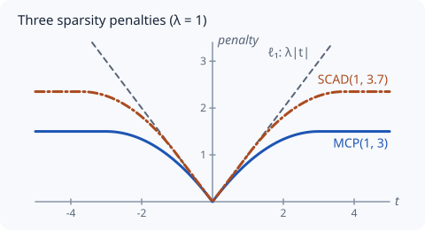
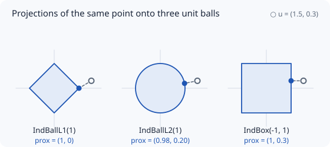

# [Function catalog](@id function-catalog)

Every function is a Julia object: construct it with its parameters, then evaluate it
and, where ProximalBase implements them, take its gradient or proximal step. Find the
function by the role it plays in your model; each name links to its reference
entry. Which operations and storage each one supports is in the
[capability tables](@ref capability-tables).

## If your model needs…

| If your model needs… | use |
|:--|:--|
| squared-error regression | [`LeastSquaresLoss`](@ref) |
| binary outcomes (logistic regression) | [`LogisticLoss`](@ref) |
| counts (Poisson regression) | [`PoissonLoss`](@ref) |
| the square-root lasso's data term | [`SqrtLeastSquaresLoss`](@ref) |
| a sparse inverse covariance (graphical lasso) | [`LogDetLoss`](@ref), with a weighted [`NormL1`](@ref) |
| sparse coefficients (lasso) | [`NormL1`](@ref) |
| sparse coefficients among correlated predictors | [`ElasticNet`](@ref) |
| sparse, nonnegative coefficients | [`NormL1Nonneg`](@ref) |
| less shrinkage of large coefficients | [`MCP`](@ref) or [`SCAD`](@ref) (nonconvex) |
| a cost per nonzero coefficient | [`NormL0`](@ref) (nonconvex) |
| a cost per nonzero off-diagonal entry of a symmetric matrix | `NormL0(λ; diagonal = false)` (nonconvex) |
| at most ``s`` nonzero coefficients | [`IndBallL0`](@ref) (nonconvex) |
| whole groups selected together (group lasso) | [`GroupNormL2`](@ref) |
| groups, and sparsity within groups | [`SparseGroupNormL2`](@ref) |
| group selection with less shrinkage | [`GroupMCP`](@ref) or [`GroupSCAD`](@ref) (nonconvex) |
| one Euclidean norm, not squared | [`NormL2`](@ref) |
| the largest magnitude | [`NormLinf`](@ref) |
| a ridge penalty | [`SqrNormL2`](@ref) |
| a general quadratic | [`QuadraticFunction`](@ref) |
| an affine term, or no term | [`LinearFunction`](@ref), [`ZeroFunction`](@ref) |
| bounds on each coefficient | [`IndBox`](@ref), [`IndNonnegative`](@ref) |
| a norm-ball constraint | [`IndBallL1`](@ref), [`IndBallL2`](@ref), [`IndBallLinf`](@ref) |
| a positive multiple ``\alpha f`` of a function | `α * f` ([`Scaled`](@ref)) |

Some functions play more than one role: `SqrNormL2` is a ridge penalty or a squared
distance, and `IndBallL1` is the constraint counterpart of the penalty `NormL1`. To
combine a loss and a penalty, evaluate them separately and add the values,
`f(x) + g(x)`; there is no object for a sum of functions.

## Losses

| Function | Definition | Constructor | Convex |
|:--|:--|:--|:-:|
| [`LeastSquaresLoss`](@ref) | ``\tfrac12\|y-X\beta\|_2^2`` | `LeastSquaresLoss(y, X)` | ✓ |
| [`LogisticLoss`](@ref) | ``\sum_i w_i[\log(1+e^{\eta_i})-y_i\eta_i]``, ``\eta=X\beta+o`` | `LogisticLoss(y, X; weights, offset)` | ✓ |
| [`PoissonLoss`](@ref) | ``\sum_i[e^{\eta_i}-y_i\eta_i]``, ``\eta=X\beta`` | `PoissonLoss(y, X)` | ✓ |
| [`SqrtLeastSquaresLoss`](@ref) | ``\|y-X\beta\|_2`` | `SqrtLeastSquaresLoss(y, X)` | ✓ |
| [`LogDetLoss`](@ref) | ``w[\operatorname{tr}(S\Theta)-\log\det\Theta]``, ``\Theta`` symmetric positive definite | `LogDetLoss(S, w = 1)` | ✓ |

- With an ``n\times k`` response ``Y``, `LeastSquaresLoss` is ``\tfrac12\|Y-XB\|_F^2``.
- `LogisticLoss` defaults to unit weights ``w_i=1`` and zero offset ``o``.
  `PoissonLoss` takes `Float64` data. `LogDetLoss` needs a finite, exactly symmetric
  ``S`` and a finite ``w>0``.
- These are sums over observations. For the mean, multiply the first three by ``1/n``;
  for the normalized square-root lasso, multiply `SqrtLeastSquaresLoss` by ``1/\sqrt n``.

## Sparsity penalties

| Function | Definition | Constructor | Convex |
|:--|:--|:--|:-:|
| [`NormL1`](@ref) | ``\lambda\sum_i w_i\lvert x_i\rvert`` | `NormL1(λ, w)` | ✓ |
| [`ElasticNet`](@ref) | ``\lambda_1\sum_i w_i\lvert x_i\rvert+\tfrac{\lambda_2}2\|x\|_2^2`` | `ElasticNet(λ1, λ2, w)` | ✓ |
| [`NormL1Nonneg`](@ref) | ``\lambda\sum_i w_ix_i`` if every ``x_i\ge0``, ``+\infty`` otherwise | `NormL1Nonneg(λ, w)` | ✓ |
| [`MCP`](@ref) | ``\sum_i p_{\lambda,a}(x_i)`` | `MCP(λ, a = 3)` | — |
| [`SCAD`](@ref) | ``\sum_i p_{\lambda,a}(x_i)`` | `SCAD(λ, a = 3.7)` | — |
| [`NormL0`](@ref) | ``\lambda\cdot\#\{i: x_i\ne0\}`` | `NormL0(λ = 1)` | — |
| off-diagonal ℓ₀ | ``\lambda\cdot\#\{(i,j): i\ne j,\ X_{ij}\ne0\}`` | `NormL0(λ; diagonal = false)` | — |

Weights ``w`` are optional (all one by default); `NormL1()` and `NormL1Nonneg()` also
default to ``\lambda=1``. The MCP and SCAD penalties ``p_{\lambda,a}`` are defined in
their entries.

## Norm and group penalties

| Function | Definition | Constructor | Convex |
|:--|:--|:--|:-:|
| [`NormL2`](@ref) | ``\lambda\|x\|_2`` | `NormL2(λ = 1)` | ✓ |
| [`NormLinf`](@ref) | ``\lambda\max_i\lvert x_i\rvert`` | `NormLinf(λ = 1)` | ✓ |
| [`GroupNormL2`](@ref) | ``\lambda\sum_k w_k\|x_{G_k}\|_2`` | `GroupNormL2(λ, groups, w)` | ✓ |
| [`SparseGroupNormL2`](@ref) | ``\lambda_1\sum_{i\in\cup_k G_k}\lvert x_i\rvert+\lambda_2\sum_k w_k\|x_{G_k}\|_2`` | `SparseGroupNormL2(λ1, λ2, groups, w)` | ✓ |
| [`GroupNormLinf`](@ref) | ``\lambda\sum_k w_k\max_{i\in G_k}\lvert x_i\rvert`` | `GroupNormLinf(λ, groups, w)` | ✓ |
| [`GroupMCP`](@ref) | ``\sum_k p_{\lambda w_k,a}(\|x_{G_k}\|_2)`` | `GroupMCP(λ, groups, w; a = 3)` | — |
| [`GroupSCAD`](@ref) | ``\sum_k p_{\lambda w_k,a}(\|x_{G_k}\|_2)`` | `GroupSCAD(λ, groups, w; a = 3.7)` | — |

Groups are disjoint; indices in no group are not penalized. Weights are optional, with
defaults ``\sqrt{\lvert G_k\rvert}``, except ``1`` for `GroupNormLinf`. For a matrix,
``\|x\|_2`` is the Frobenius norm and groups use linear indices.

## Constraints

| Function | Set | Constructor | Convex |
|:--|:--|:--|:-:|
| [`IndBox`](@ref) | ``l_i\le x_i\le u_i`` | `IndBox(l, u)` | ✓ |
| [`IndBallLinf`](@ref) | ``\max_i\lvert x_i\rvert\le r`` | `IndBallLinf(r)` | ✓ |
| [`IndNonnegative`](@ref) | ``x_i\ge0`` | `IndNonnegative()` | ✓ |
| [`IndBallL1`](@ref) | ``\|x\|_1\le r`` | `IndBallL1(r = 1)` | ✓ |
| [`IndBallL2`](@ref) | ``\|x\|_2\le r`` | `IndBallL2(r = 1)` | ✓ |
| [`IndBallL0`](@ref) | at most ``s`` counted nonzeros | `IndBallL0(s; diagonal = true)` | — |

A constraint is represented by its indicator, zero on the set and ``+\infty`` outside;
its proximal step is the Euclidean projection onto the set. `IndBallL0` takes an integer
budget ``s``; `diagonal = false` leaves the diagonal of a matrix uncounted.

## Quadratic, linear and scaled functions

| Function | Definition | Constructor | Convex |
|:--|:--|:--|:-:|
| [`SqrNormL2`](@ref) | ``\tfrac\lambda2\|x-c\|_2^2`` | `SqrNormL2(λ = 1)`, `SqrNormL2(λ, c)` | ✓ |
| [`QuadraticFunction`](@ref) | ``\tfrac12x^\top Ax+b^\top x+c`` | `QuadraticFunction(A, b = nothing, c = 0)` | ◐ |
| [`KronQuadratic`](@ref) | ``\tfrac12\langle X,AXB\rangle_F+\langle C,X\rangle_F`` | `KronQuadratic(A, B, C = nothing)` | ◐ |
| [`LinearFunction`](@ref) | ``\langle c,x\rangle+d`` | `LinearFunction(c, d = 0)` | ✓ |
| [`ZeroFunction`](@ref) | ``0`` | `ZeroFunction()` | ✓ |
| [`Scaled`](@ref) | ``\alpha f(x)`` | `α * f` or `Scaled(f, α)` | as ``f`` |

- `QuadraticFunction` assumes a symmetric ``A`` and does not check it; it is convex
  when ``A`` is positive semidefinite. `KronQuadratic` needs exactly symmetric ``A`` and
  ``B``; it is convex, for example, when both are positive semidefinite. Omitted ``b``
  and ``C`` are zero.
- `SqrNormL2` has center ``c=0`` when it is omitted. For a matrix, its norm is Frobenius.
- For `Scaled`, the table describes a finite positive ``\alpha``; zero and infinite
  scales follow the [scaling rules](@ref scaling-guide).

In the **Convex** column, ✓ means convex for every valid parameter choice, ◐ convex
under the stated condition, and — not convex in general (a degenerate choice such as
``\lambda=0`` can still be convex).

## Not what you need?

- To write a function that is not here, see [Writing your own function](extending.md).
- To fit a model without writing an algorithm, see [ProximalSolvers](@ref with-proximalsolvers).
