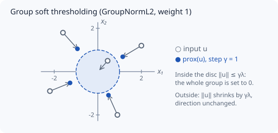

# Norm and group penalties (prototype: `GroupNormL2` entry)

*In the implementation this entry sits in `group_penalty.md` after `NormL2` and
`NormLinf`, followed by `SparseGroupNormL2`, `GroupNormLinf`, `GroupMCP` and `GroupSCAD`.*

## [Group lasso: `GroupNormL2`](@id entry-groupnorml2)

The group-lasso penalty. It sets whole groups of coefficients to zero together,
for example all dummy variables of one categorical predictor.

```math
g(x)=\lambda\sum_{k}w_k\,\|x_{G_k}\|_2,\qquad \lambda\ge0,\ w_k\ge0,
```

where ``G_1,G_2,\dots`` are disjoint groups of indices. Indices in no group are
not penalized.

| Constructor | Meaning |
|:--|:--|
| `GroupNormL2(λ, groups)` | default weights ``w_k=\sqrt{\lvert G_k\rvert}`` |
| `GroupNormL2(λ, groups, w)` | one weight per group |

`groups` is a vector of index vectors or ranges, such as `[1:2, 3:5]` or
`[[1, 4], [2, 3]]`. The constructor checks that groups are nonempty, disjoint and
contain positive indices, and that `λ` and the weights are nonnegative and not `NaN`.
It copies `groups` and `w`.

```@example entry-gl
using ProximalBase

g = GroupNormL2(1.0, [1:2, 3:4])
g.w                                   # √2 for each group of two
```

```@example entry-gl
x = [3.0, 4.0, 0.1, 0.1]
prox(g, x, 1.0)                       # the second group becomes zero
```

### Proximal operator: group soft thresholding

```math
\operatorname{prox}_{\gamma g}(v)_{G_k}=
\max\Bigl(1-\frac{\gamma\lambda w_k}{\|v_{G_k}\|_2},\ 0\Bigr)\,v_{G_k}.
```

A group whose norm is at most ``\gamma\lambda w_k`` becomes zero. Any other group
keeps its direction and its norm decreases by ``\gamma\lambda w_k``.



| Operation | Call | Supported |
|:--|:--|:--|
| value | `g(x)` | ✓ |
| proximal step | `prox(g, x, γ)`, `prox!(out, g, x, γ)` | ✓ scalar step ``\gamma\ge0`` |
| value at the new point | `value_and_prox!(out, g, x, γ)` | ✓ |
| one group | `prox_block(g, u, k, γ)` on the group's entries `u` | ✓ returns a new vector; does not write into an iterate |
| optimality score | `kkt_violation(g, v, x, k)`, `(g, v, x)` | ✓ per group or whole point; `k` is an entry index for an array, a group number for a `BlockIterate` |
| one coordinate | `prox_block(g, xᵢ, i, γ)` | — groups are not separable |
| restriction | `restrict(g, S)` | — |
| gradient | `gradient(g, x)` | — |

### Inputs and storage

✓ vectors, matrices (groups use linear indices) and strided views ·
✓ `SparseIterate` · ✓ `BlockIterate` (its groups must cover every index, so add
singleton groups for unpenalized entries) ·
— `SymmetricSparseIterate`; use `Matrix(x)` instead.
Element types: `Float64` or `Float32`, the same type for data, parameters, step and
output ([precision rules](@ref numerical-usage)).

### Good to know

- To update one group of a `BlockIterate`, compute the block with `prox_block`
  and write it with `copyto!(blockview(x, k), out)`.
- The order of indices within a group sets the order of the compact vector
  `u` passed to `prox_block`: for the group `[4, 1]`, `u = [x[4], x[1]]`.
- `prox_block` is not available for `Scaled(g, α)`; scale ``\lambda`` instead.
- Negative and `NaN` steps throw `ArgumentError` before anything is written.

**See also:** [`SparseGroupNormL2`](@ref) (adds an ℓ₁ term within groups),
[`GroupMCP`](@ref) and [`GroupSCAD`](@ref) (nonconvex group penalties),
[`GroupNormLinf`](@ref), [`NormL2`](@ref) (one group containing everything) ·
[guarantees](@ref spec-groupnorml2) · [API](@ref GroupNormL2)
