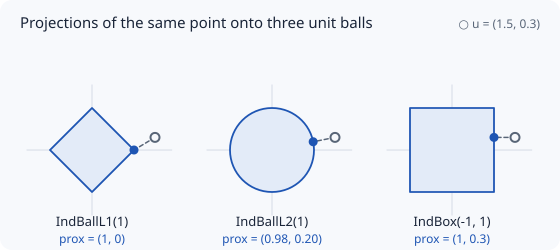

# Constraints (prototype: `IndBallL1` entry)

*In the implementation this entry is part of the new `constraints.md`, which opens
with a short explanation of indicator functions and projections and the figure
below, followed by `IndBox`, `IndBallLinf`, `IndNonnegative`, `IndBallL2` and `IndBallL0`.*

A constraint ``x\in C`` is written as its *indicator function*: zero on ``C`` and
``+\infty`` outside. For a nonempty closed set and a supported step, its proximal
operator is, in exact arithmetic, the Euclidean projection onto ``C``: a nearest point of
``C`` (the nearest point, when ``C`` is convex). Each constraint's entry gives its rules
for structured inputs and non-finite values.



## [ℓ₁ ball: `IndBallL1`](@id entry-indballl1)

The constraint ``\|x\|_1\le r``. Its projection can set small entries exactly to zero.

```math
\iota_{\{\|x\|_1\le r\}}(x)=\begin{cases}0,&\sum_i|x_i|\le r,\\ +\infty,&\text{otherwise,}\end{cases}
\qquad r\ge0.
```

For a matrix the sum runs over all entries.

| Constructor | Meaning |
|:--|:--|
| `IndBallL1(r = 1)` | ball of radius `r` |

`r` must be nonnegative and not `NaN`; `0` and `Inf` are allowed.

```@example entry-l1ball
using ProximalBase

C = IndBallL1(1.0)
x = [2.0, -1.0, 0.5]
C(x)                    # outside the ball
```

```@example entry-l1ball
z = prox(C, x)          # the projection; the step may be omitted
z, sum(abs, z)
```

### Projection

A point inside the ball is returned unchanged. For a finite point outside a ball of
positive finite radius, the projection soft thresholds every entry,
``z_i=\operatorname{sign}(x_i)\max(|x_i|-\tau,0)``, at the level ``\tau>0`` for which
``\sum_i\max(|x_i|-\tau,0)=r``. Zero and infinite radii, infinite entries and `NaN`
follow the [endpoint rules](@ref spec-indballl1-endpoints).

| Operation | Call | Supported |
|:--|:--|:--|
| value | `C(x)` | ✓ `0.0` inside, `Inf` outside; `NaN` if an entry is `NaN` |
| projection | `prox(C, x, γ)`, `prox!(out, C, x, γ)` | ✓ any scalar ``\gamma\ge0``, or none; a negative or `NaN` step throws before writing |
| value at the new point | `value_and_prox!(out, C, x, γ)` | ✓ returns `C(out)`: normally `0.0`, but rounding of the stored projection can give `Inf`, and a `NaN` projection gives `NaN` |
| gradient, `lipschitz` | | — |
| one coordinate or group | `prox_block` | — the ball couples all entries |
| optimality score | `kkt_violation` | — |

`prox!(x, C, x, γ)` may overwrite its input; an output that partly overlaps the input
is not supported.

### Inputs and storage

✓ vectors, matrices and strided views ·
✓ `SparseIterate`: the value, and a projection into another `SparseIterate`, visit
stored entries, except when the result is filled with `NaN` ·
✓ `BlockIterate` (uses the whole vector) ·
◐ `Symmetric` matrices: the projection is a dense `Matrix` ·
— `SymmetricSparseIterate`; use `Matrix(x)`.
Element types: `Float64` or `Float32`, the same type for data, parameters, step and
output ([precision rules](@ref numerical-usage)).

### Good to know

- Membership is decided with the computed sum of magnitudes, with no tolerance,
  so rounding can decide a point on the boundary.
- `α * C` is `C` itself for every `α ≥ 0`, including `0` and `Inf`: a ProximalBase
  convention for indicators ([guarantees](@ref spec-indballl1)).
- When the projection cannot use the output array as workspace, it uses a buffer
  stored in `C`. Use a separate `IndBallL1(r)` in each task that may run
  concurrently ([details](@ref IndBallL1)).

**See also:** [`NormL1`](@ref) (the penalty form), [`IndBallL2`](@ref),
[`IndBox`](@ref) and [`IndBallLinf`](@ref) (other balls),
[`IndBallL0`](@ref) (at most ``s`` nonzero entries) ·
[guarantees](@ref spec-indballl1) · [API](@ref IndBallL1)
