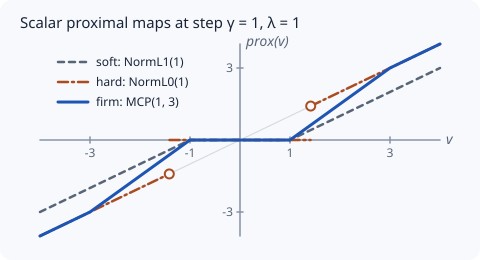

# Sparsity penalties (prototype: `NormL1` entry)

*In the implementation this entry opens `penalties.md`, followed by `ElasticNet`,
`NormL1Nonneg`, `MCP`, `SCAD` and `NormL0` in the same format.*



## [Weighted ℓ₁ norm: `NormL1`](@id entry-norml1)

The lasso penalty. It encourages coefficients that are exactly zero.

```math
g(x)=\lambda\sum_{i}w_i\,|x_i|,\qquad \lambda\ge 0,\ w_i\ge 0.
```

For a matrix the sum runs over all entries. A weight of zero leaves its entry
unpenalized. With finite positive weights and a finite ``\lambda>0``, ``g`` is a norm.

| Constructor | Meaning |
|:--|:--|
| `NormL1(λ = 1)` | all weights equal to one |
| `NormL1(λ, w)` | one weight per entry of ``x``, matched by linear index |

`λ` and the weights must be nonnegative and not `NaN`; `Inf` is allowed. This is
checked when the object is constructed. The weight array is kept by reference,
so changing it later changes the function.

```@example entry-norml1
using ProximalBase

g = NormL1(0.5)
x = [2.0, -1.0, 0.25]
g(x)
```

```@example entry-norml1
prox(g, x, 1.0)
```

```@example entry-norml1
h = NormL1(0.5, [1.0, 0.0, 2.0])   # the second entry is not penalized
prox(h, x, 1.0)
```

### Proximal operator: soft thresholding

```math
\operatorname{prox}_{\gamma g}(v)_i=\operatorname{sign}(v_i)\,
\max\bigl(|v_i|-\gamma\lambda w_i,\ 0\bigr).
```

Each entry moves toward zero by its own threshold ``\gamma\lambda w_i`` and stops at zero.

| Operation | Call | Supported |
|:--|:--|:--|
| value | `g(x)` | ✓ |
| proximal step | `prox(g, x, γ)`, `prox!(out, g, x, γ)` | ✓ scalar step or one step per entry |
| value at the new point | `value_and_prox!(out, g, x, γ)` | ✓ returns ``g(\text{out})`` |
| one coordinate | `prox_block(g, xᵢ, i, γ)` | ✓ |
| optimality score | `kkt_violation(g, v, i)`, `(g, v, x, i)`, `(g, v, x)` | ✓ |
| restriction | `restrict(g, S)` | ✓ |
| gradient | `gradient(g, x)` | — not differentiable at zero |

### Inputs and storage

✓ vectors, matrices and strided views of them ·
✓ `SparseIterate` (visits stored entries only) ·
✓ `BlockIterate` ·
◐ `SymmetricSparseIterate`: weights must form a symmetric ``p\times p`` array, the step must be a scalar, and the optimality score is available per coordinate only ·
◐ `Symmetric` matrices: `prox` returns a dense `Matrix`.
Element types: `Float64` or `Float32`, the same type for data, parameters, step and
output ([precision rules](@ref numerical-usage)).

### Good to know

- The step is not checked. A negative or `NaN` step returns a result without
  mathematical meaning ([shared step rule](@ref numerics)).
- Off-diagonal entries of a `SymmetricSparseIterate` count twice in the value,
  because each stands for two matrix entries.
- An infinite weight fixes a finite entry at zero. For an infinite input or a
  `NaN` input, see the [guarantee page](@ref spec-norml1-endpoints).
- `prox!(x, g, x, γ)` may overwrite its input. A different array that shares memory
  with `x` is not supported.

**See also:** [`ElasticNet`](@ref) (adds a ridge term),
[`NormL1Nonneg`](@ref) (nonnegative coefficients),
[`MCP`](@ref) and [`SCAD`](@ref) (less bias for large coefficients),
[`IndBallL1`](@ref) (an ℓ₁ constraint instead of a penalty) ·
[guarantees](@ref spec-norml1) · [API](@ref NormL1)
