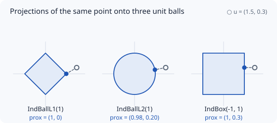
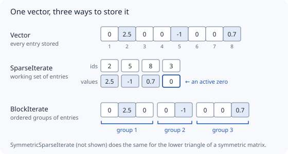

# Mathematical visualizations

Five prototype figures, each meant for a specific page. They are SVG files written
by [`figures/generate_figures.py`](../figures/generate_figures.py), which uses only the
Python standard library and copies the style and colors of
`docs/generate_learn_figures.py`. The Python script draws each curve from a closed
form. [`figures/check_figures.jl`](../figures/check_figures.jl) writes the same closed
forms again in Julia and checks them against ProximalBase: penalty values and scalar
proximal maps on a grid of 2,001 points, and the group-shrinkage and projection points
that are plotted. It does not read the SVG coordinates, so the two scripts must be kept
in step by hand; G8 removes that duplication (see below).

## Penalties: ℓ₁, MCP and SCAD

*For the sparsity-penalties page and the catalog.* SCAD equals the ℓ₁ penalty on its
first piece and MCP starts with the same slope; both then level off, so they stop
penalizing large coefficients further. This is the usual motivation for using them
instead of the lasso. Values: `NormL1(1)`, `MCP(1, 3)`, `SCAD(1, 3.7)`.

## Soft, hard and firm thresholding

*For the sparsity-penalties page, next to each function's proximal operator.* Soft
thresholding (`NormL1`) shrinks every surviving entry, hard thresholding (`NormL0`)
keeps or removes an entry, and firm thresholding (`MCP` at a step below `a`) shrinks
moderately large entries less and leaves large ones unchanged. The open circles mark
the jump of hard thresholding at magnitude ``\sqrt{2\gamma\lambda}``. The curve is the
exact rule for positive finite parameters: keep ``v`` when ``v^2>2\gamma\lambda`` and
return zero otherwise, including at an exact tie. ProximalBase decides the comparison
exactly when the input, the level and the step are finite and of the same type, `Float32`
or `Float64`. For example, the floating-point number `sqrt(2.0)` lies slightly above the
exact cutoff ``\sqrt2`` and is kept at ``\gamma=\lambda=1``.

## Group shrinkage

*For the `GroupNormL2` entry.* The whole group either becomes zero or keeps its
direction and loses length ``\gamma\lambda w_k``. This is what group sparsity means,
and it is hard to convey with formulas alone. The existing Learn figure shows one
point; this one shows the rule.

## Projections onto constraint sets

*For the constraints page.* One point, three sets, three different nearest points. The
ℓ₁ projection lands on a vertex, ``(1, 0)``, and so sets the second coordinate to zero:
this is how an ℓ₁ constraint produces sparse solutions. Values: `IndBallL1(1.0)`,
`IndBallL2(1.0)`, `IndBox(-1.0, 1.0)`.

## Structured iterates

*For the iterate overview.* It shows three ideas the iterate pages spend many
paragraphs on: a dense vector stores everything, a `SparseIterate` keeps a working set
that may deliberately contain a zero, and a `BlockIterate` works with ordered groups.

## Maintaining the figures

- **No new dependency.** Python's standard library writes the SVG and Julia checks the
  numbers. No plotting package enters the documentation environment.
- **Running the scripts.** `python3 generate_figures.py` rewrites the SVG files next to
  it; `--check` only compares them with the generated output and changes nothing.
- **Implementation (G8).** The drawing functions move into
  `docs/generate_learn_figures.py`. To remove the duplicated formulas, the plotted
  coordinates are computed once in Julia by ProximalBase itself (a small script run in
  the documentation build writes them for the Python generator, or the check compares
  the SVG points with ProximalBase directly). Today `generate_learn_figures.py --check`
  runs only by hand, so G8 also adds it to the documentation job.
- **Accessibility.** Each SVG has a `<title>` and `<desc>`, every image in the manual
  gets alternative text, and no curve is identified by color alone: curves differ by
  dash pattern (one solid, the others dashed) and carry a label or a legend entry. The
  figures carry their own light background, so they read the same in Documenter's
  light and dark themes.
- **Cost.** About 30 lines of Python per figure.
