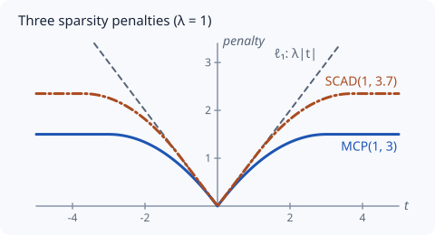
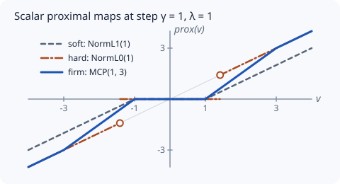
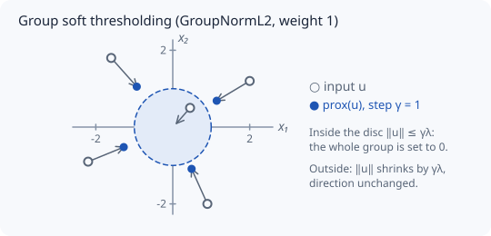

# Mathematical visualizations

Five prototype figures, each meant for a specific page. They are SVG files written
by [`figures/generate_figures.py`](../figures/generate_figures.py), which uses only the
Python standard library and copies the style and colors of
`docs/generate_learn_figures.py`. Every curve and point is computed from a closed form, and
[`figures/check_figures.jl`](../figures/check_figures.jl) checks those closed forms
against ProximalBase on a grid of 2,001 points (penalty values and scalar proximal maps)
and at every plotted point (group shrinkage and projections).

## Penalties: ℓ₁, MCP and SCAD

*For the sparsity-penalties page and the catalog.* It shows why MCP and SCAD are used:
they penalize small coefficients like the lasso but stop penalizing large ones, which
reduces the bias of large estimates. Values: `NormL1(1)`, `MCP(1, 3)`, `SCAD(1, 3.7)`.

## Soft, hard and firm thresholding

*For the sparsity-penalties page, next to each function's proximal operator.* The figure
makes the three behaviors visible at once: soft thresholding (`NormL1`) shrinks every
surviving entry, hard thresholding (`NormL0`) keeps or kills, and firm thresholding (`MCP`
at a step below `a`) shrinks moderately large entries and leaves large ones unchanged. The
open circles mark the jump of hard thresholding at ``\sqrt{2\gamma\lambda}``, where
ProximalBase returns zero on an exact tie.

## Group shrinkage

*For the `GroupNormL2` entry.* The whole group either becomes zero or keeps its direction
and loses length ``\gamma\lambda w_k``. This is what "group sparsity" means and is hard to
convey with formulas alone. The existing Learn figure shows one point; this one shows the
rule.

## Projections onto constraint sets

*For the constraints page.* One point, three sets, three different nearest points. The
ℓ₁ projection lands on a face with a smaller second coordinate, which is how an ℓ₁
constraint promotes sparsity. Values: `IndBallL1(1.0)`, `IndBallL2(1.0)`, `IndBox(-1.0, 1.0)`.

## Structured iterates

*For the iterate overview.* It shows the three ideas the iterate pages spend many
paragraphs on: a dense vector stores everything, a `SparseIterate` stores a working set
that may deliberately contain a zero, and a `BlockIterate` works with ordered groups.

## Maintaining the figures

- **No new dependency.** Python's standard library writes the SVG; Julia checks the
  numbers. Neither Plots.jl nor a plotting library enters the documentation environment.
- **Implementation.** G9 would move these drawing functions into
  `docs/generate_learn_figures.py` and the numerical check into a Documenter
  `@example` block or the examples run, so that the strict documentation build fails if
  ProximalBase's results change. Today `generate_learn_figures.py --check` is run only by hand
  (no CI step), so G9 should also add it to the documentation job.
- **Accessibility.** Each SVG has a `<title>` and `<desc>`, every image in the manual
  gets alternative text, and no curve is identified by color alone: each also has
  a dash pattern and a label. The figures carry their own light background, so they
  read the same in Documenter's light and dark themes.
- **Cost.** About 30 lines of Python per figure. A figure needs changing only when a
  formula or a default changes, which the Julia check detects.
