# [Package structure](@id architecture)

ProximalBase supplies function objects and the operations used by optimization
algorithms. The calling solver owns the iteration, stopping rule and working
set. Inside the package, Julia's abstract types organize related functions,
traits describe their capabilities, and multiple dispatch selects an operation
for a function and an array type.

| Question | Main abstraction | Where to look |
|:---|:---|:---|
| What mathematical function is represented? | `AbstractFunction` and its concrete subtypes | Losses, penalties, sets and wrappers |
| Which operations does it support? | Capability traits such as `issmooth` and `isproximable` | [The interface](@ref) |
| Can an update act on one entry or group? | `SeparableFunction`, grouped penalties and coordinate methods | [Coordinate descent](@ref) |
| How is the iterate stored? | `SparseIterate`, `SymmetricSparseIterate`, `AtomIterate` | [Sparse iterates](@ref) |
| Does an operation transform or delegate to another function? | Composition wrappers | [Functions built from functions](@ref) |
| Who owns temporary state? | Function-owned buffers and decomposition workspaces | [State and device methods](@ref architecture-state) |

The figures show representative types and call paths. A box containing several
names is a group of examples, not another Julia type. The relationships are
checked against the source links below; the figures are a guide rather than a
complete declaration inventory. Names shown for internal kernels and types
explain the implementation and are not additional public extension points.

## Reading the figures

| Edge | Meaning |
|:---|:---|
| Thin arrow, `-->` | Subtyping, from subtype to parent; used in the type and storage figures |
| Circle end, `--o` | Composition, from an object to something it contains |
| Dotted arrow, `-.->` | Dispatch or selection; the edge label identifies the choice |
| Thick arrow, `==>` | A runtime call or computational step |
| Dotted edge labeled `same binding` | A compatibility alias, not a subtype |

## [Function types and traits](@id architecture-functions)

[Mermaid source](assets/architecture/01-types.mmd).

`SeparableFunction` supplies entrywise operations such as `value_entry` and
`prox_entry`. Group penalties instead update blocks; the internal
`HomogeneousGroupNorm` subtype identifies the positively homogeneous group
norms used by shared kernels. `GroupMCP` and `GroupSCAD` use a different
mathematical rule and are not homogeneous group norms.

Traits describe capabilities independently of this hierarchy. A function may
be smooth, proximable, convex and separable at the same time. For example,
`SqrNormL2` has both a gradient and a proximal operator. A solver queries the
traits instead of looking for a separate abstract class for every capability.

`ScalarLoss` is a separate hierarchy. `GLMLoss` contains a scalar observation
loss together with its design and response data. `LogisticLoss`, `PoissonLoss`
and `HuberLoss` construct specializations of `GLMLoss`. The qualified binding
`ProximalBase.AbstractGroupNorm` is a compatibility alias for
`ProximalBase.AbstractGroupPenalty`; it does not establish convexity or
homogeneity. See [Compatibility and migration](@ref).

Representative source: [interface and traits](https://github.com/mlakolar/ProximalBase.jl/blob/6004c42d90e51f2410eb8147b454f2ad16e25bdc/src/interface.jl),
[separable functions](https://github.com/mlakolar/ProximalBase.jl/blob/6004c42d90e51f2410eb8147b454f2ad16e25bdc/src/functions/separable.jl),
[group types](https://github.com/mlakolar/ProximalBase.jl/blob/6004c42d90e51f2410eb8147b454f2ad16e25bdc/src/functions/norms.jl),
[scalar losses and GLMLoss](https://github.com/mlakolar/ProximalBase.jl/blob/6004c42d90e51f2410eb8147b454f2ad16e25bdc/src/functions/glm.jl).

## [Public operations and their kernels](@id architecture-calls)

[Mermaid source](assets/architecture/02-oracles.mmd).

The mutating interface takes the output first: `prox!(y, f, x, γ)` and
`gradient!(g, f, x)`. The combined operations also return the function value,
which lets a caller reuse work. The default `gradient!` delegates to
`value_and_gradient!`; concrete methods can override that fallback.

| Example call | Principal computational path |
|:---|:---|
| `prox!(y, NormL1(λ), x, γ)` | Separable array method → `prox_entry` → soft thresholding |
| `value_and_prox!` for a group norm | Group method → group norm and shrinkage kernels → value at the output |
| `prox_coordinate!` on an `AtomIterate` | Stored-coordinate lookup → scalar or group update, depending on the penalty |
| `gradient!` for a `GLMLoss` | Linear predictor → scalar loss derivatives → transpose-design multiplication |
| `hessian_vec!` for a `GLMLoss` | Scalar second derivatives → weighted design products |
| `quadratic_model` for a `GLMLoss` | Working response and curvature weights → weighted least-squares model |

GLM quadratic models floor observation curvature; where the floor is active,
the model is not the exact Hessian. Numerical helpers for scaled norms and
exceptional products sit below these dispatch boundaries. They protect the
corresponding kernels without adding public operations.

Representative source: [separable methods](https://github.com/mlakolar/ProximalBase.jl/blob/6004c42d90e51f2410eb8147b454f2ad16e25bdc/src/functions/separable.jl),
[group kernels](https://github.com/mlakolar/ProximalBase.jl/blob/6004c42d90e51f2410eb8147b454f2ad16e25bdc/src/functions/norms.jl),
[second-order methods](https://github.com/mlakolar/ProximalBase.jl/blob/6004c42d90e51f2410eb8147b454f2ad16e25bdc/src/second_order.jl),
[numerical helpers](https://github.com/mlakolar/ProximalBase.jl/blob/6004c42d90e51f2410eb8147b454f2ad16e25bdc/src/utils.jl).

## [Composition and constrained functions](@id architecture-composition)

[Mermaid source](assets/architecture/03-composition.mmd).

Wrappers compose functions by containing them. `Scaled`, `Tilt`, `Translate`,
`Conjugate`, `Precompose`, `Regularize` and `MoreauEnvelope` transform the
mathematical problem and delegate suitable operations to their inner function.
`Sum`, `SeparableSum`, `SliceSum` and `FiberSum` combine terms or split arrays
into blocks. Their trait methods determine which operations the combination
can provide.

`Constrained(f, set)` is a constructor that chooses a concrete wrapper by
dispatch on the function and the set. A box-constrained scalar step clamps the
inner proximal point. The caller must ensure that the constraint meets the
domain of the inner function. Hyperplane and halfspace methods use a multiplier
search with the limitations described in [Functions built from functions](@ref).

`Conjugate` uses Moreau decomposition for a proximal step. Its combined
value/prox method can use Fenchel equality at the computed point; this does
not create a general standalone conjugate-value solver. Where the inner point
`γ prox_{f/γ}(x/γ)` has a form free of the step (positively homogeneous
functions and cones, the ℓ2 ball and the box, their translations and positive
rescalings, and the double conjugate), the input is never divided by the step,
and the result has the accuracy of a unit step, about eps times the largest
input entry; with array steps and in `prox_entry` this covers only the
indicator conjugates of separable functions, the box and the double conjugate.
The other conjugates check that a finite input gives a finite result before
writing.

Representative source: [basic wrappers](https://github.com/mlakolar/ProximalBase.jl/blob/6004c42d90e51f2410eb8147b454f2ad16e25bdc/src/calculus.jl),
[compositions](https://github.com/mlakolar/ProximalBase.jl/blob/6004c42d90e51f2410eb8147b454f2ad16e25bdc/src/composition.jl),
[scalar constraints](https://github.com/mlakolar/ProximalBase.jl/blob/6004c42d90e51f2410eb8147b454f2ad16e25bdc/src/constrained.jl),
[balls and spheres](https://github.com/mlakolar/ProximalBase.jl/blob/6004c42d90e51f2410eb8147b454f2ad16e25bdc/src/ballconstrained.jl).

## [Iterates and coordinate storage](@id architecture-storage)

[Mermaid source](assets/architecture/04-storage-device.mmd).

`SparseIterate` stores selected entries and index maps. `SymmetricSparseIterate`
stores the lower triangle of a symmetric matrix; one stored off-diagonal
coordinate represents two matrix entries. Its coordinate view is distinct
from ordinary matrix linear indexing. `AtomIterate` stores dense data together
with the active groups used by block updates.

Coordinate methods translate a storage coordinate into the appropriate entry
or group. Full-array methods use the array interface or specialized stored-entry
loops. See [Sparse iterates](@ref) before mixing storage coordinates with array
indices.

Representative source: [sparse and symmetric storage](https://github.com/mlakolar/ProximalBase.jl/blob/6004c42d90e51f2410eb8147b454f2ad16e25bdc/src/sparse_iterate.jl),
[atom storage and updates](https://github.com/mlakolar/ProximalBase.jl/blob/6004c42d90e51f2410eb8147b454f2ad16e25bdc/src/atom_iterate.jl).

## [Matrix decompositions](@id architecture-spectral)

[Mermaid source](assets/architecture/05-spectral.mmd).

`Spectral` applies an inner vector function to eigenvalues of a symmetric
matrix; `SingularValue` applies one to singular values. The matrix primitives
`NuclearNorm`, `IndBallRank`, `TracePSD` and `IndPSD` have dedicated kernels and
an opt-in `partial=true` path.

The default uses a full decomposition. The partial path checks the represented
subspace and can fall back to a full calculation. Those checks do not certify
that every omitted leading direction was found. See [Penalties](@ref) and
[Sets](@ref) for the numerical assumptions of each operation.
The omitted-direction box annotates this limitation; it is not a runtime step.

Representative source: [matrix primitives](https://github.com/mlakolar/ProximalBase.jl/blob/6004c42d90e51f2410eb8147b454f2ad16e25bdc/src/functions/spectral.jl),
[partial decompositions](https://github.com/mlakolar/ProximalBase.jl/blob/6004c42d90e51f2410eb8147b454f2ad16e25bdc/src/partial.jl),
[eigenvalue wrappers](https://github.com/mlakolar/ProximalBase.jl/blob/6004c42d90e51f2410eb8147b454f2ad16e25bdc/src/spectralfunction.jl),
[singular-value wrappers](https://github.com/mlakolar/ProximalBase.jl/blob/6004c42d90e51f2410eb8147b454f2ad16e25bdc/src/functions/singular.jl).

## [State and device methods](@id architecture-state)

[Mermaid source](assets/architecture/06-state-device.mmd).

Some function instances own mutable scratch buffers or decomposition
workspaces, even when their outer Julia struct is immutable. Give concurrent
callers separate instances when their operations reuse those buffers.
`reset_cache!` traverses supported wrappers and invalidates documented
loss-data caches. Some objects, including `IndAffine`, must instead be
reconstructed after their defining data change.

Loading Adapt and GPUArraysCore activates the device extension. Adaptation of
a grouped penalty builds a `DeviceGroups` wrapper containing the original
function and a device group layout. Device methods use broadcasts, reductions
and matrix products. Grouped `prox!` skips function-value reductions; the
combined operation requests them from the same kernel. JLArrays checks the
reference backend; it does not establish physical-GPU compilation or timing.

Loading Test activates the extension used by `ProximalBase.Testing`. Neither
optional extension changes the public mathematical function hierarchy.

Representative source: [cache reset](https://github.com/mlakolar/ProximalBase.jl/blob/6004c42d90e51f2410eb8147b454f2ad16e25bdc/src/caches.jl),
[device methods and group layouts](https://github.com/mlakolar/ProximalBase.jl/blob/6004c42d90e51f2410eb8147b454f2ad16e25bdc/ext/ProximalBaseGPUArraysCoreExt.jl),
[Test extension](https://github.com/mlakolar/ProximalBase.jl/blob/6004c42d90e51f2410eb8147b454f2ad16e25bdc/ext/ProximalBaseTestExt.jl).
