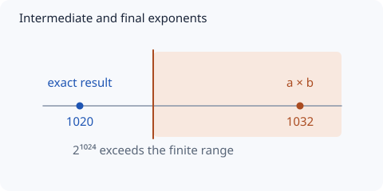

# [Floating-point range in proximal calculations](@id learn-floating-point)

The [proximal exercises](@ref learn-proximal-exercises) use small, finite
inputs. A finite input can still lead to
[intermediate overflow](../glossary.md#glossary-intermediate-overflow)
when a product exceeds the working type's range. The [numerical contracts](@ref numerics) state where ProximalBase
uses range recovery.

## [A finite product with an overflowing intermediate](@id learn-intermediate-overflow)

Take the exact powers of two ``a=2^{1020}``, ``b=2^{12}``, and
``c=2^{-12}``. The exact product is ``2^{1020}``. Multiplying ``a`` by
``b`` first would need the exponent ``1032``, beyond the finite
``\mathtt{Float64}`` range. Multiplying ``b`` by ``c`` first gives ``1``.
Both groupings represent the same real expression. The intermediate
rounding determines what each computation can carry to the final multiplication.



Predict the two results, then verify them. Power-of-two construction avoids
rounding decimal literals before the experiment.

```@example learn_exponent_range
a = ldexp(1.0, 1020)
b = ldexp(1.0, 12)
c = ldexp(1.0, -12)

@assert isinf((a * b) * c)
@assert a * (b * c) == a
true
```

## [Near the other end of the range](@id learn-subnormal-spacing)

`floatmin(Float64)` is the smallest positive normal value. The smaller
positive representable values are [subnormal](../glossary.md#glossary-subnormal).
Dividing the smallest positive representable value by two rounds to zero
in the default rounding mode.

```@example learn_subnormal_spacing
δ = nextfloat(0.0)
@assert 0.0 < δ < floatmin(Float64)
@assert δ / 2 == 0.0
true
```

For the supported operand types and the numerical range that an individual
oracle promises, follow [precision and oracle agreement](../numerics.md#Supported-precision-and-oracle-agreement)
and the [owning range clauses](@ref numerical-value-range).
