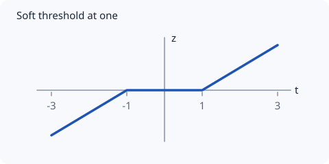
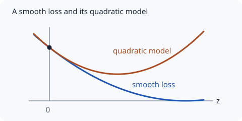
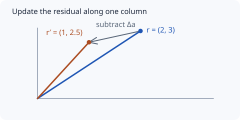
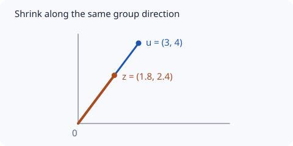

# [Proximal operations by hand](@id learn-proximal-exercises)

Start with the [first lasso problem](../getting_started.md). These exercises use
small finite inputs so you can compute the answer before calling an oracle.

## [Soft threshold a scalar](@id learn-soft-threshold-exercise)

Minimize ``\frac12(z-t)^2+\tau|z|`` for ``\tau\geq0``. For ``z>0``, the
stationarity equation gives ``z=t-\tau``. For ``z<0``, it gives
``z=t+\tau``. At ``z=0``, stationarity is possible when
``t\in[-\tau,\tau]``. Putting the three cases together gives
``\operatorname{sign}(t)\max(|t|-\tau,0)``.



Compute the results at ``t=-3,-1,0,1,2`` with ``\tau=1``. Check them with
[the NormL1 proximal operator](../penalties.md#Proximal-operator:-soft-thresholding).

```@example learn_threshold
using ProximalBase

t = [-3.0, -1.0, 0.0, 1.0, 2.0]
z = prox(NormL1(1.0), t, 1.0)
@assert z == [-2.0, 0.0, 0.0, 0.0, 1.0]
z
```

## [Take a proximal-gradient step](@id learn-proximal-gradient-exercise)

Let ``f(x)=(x-3)^2/4`` and ``g(x)=|x|/2``. At ``x=0`` and
``\gamma=1``, the smooth quadratic model is
``f(0)+f'(0)z+z^2/2``. For this loss, the difference between the model and
``f(z)`` is ``z^2/4``. Completing the square puts the model center at
``-\gamma f'(0)=1.5``. The penalty threshold is ``\gamma/2=0.5``.



Predict the next iterate and compare the objective at the two iterates. See
[gradient mapping and optimality](../proximal_gradient.md#Gradient-mapping-and-optimality)
for the interpretation of the step.

```@example learn_majorizer
using ProximalBase

loss(x) = (x - 3)^2 / 4
objective(x) = loss(x) + abs(x) / 2
x = 0.0
gradient = (x - 3) / 2
next = only(prox(NormL1(0.5), [x - gradient], 1.0))
@assert next == 1.0
@assert objective(next) == 1.5 < objective(x) == 2.25
next
```

## [Update a least-squares residual](@id learn-residual-exercise)

For one column ``a`` of the design, write the current residual as
``r=y-X\beta``. After changing coefficient ``\beta_j`` by ``\Delta``, the
residual is ``r-\Delta a``. The one-coordinate objective has smooth curvature
``a^\mathsf{T}a`` and derivative ``-a^\mathsf{T}r`` at the current coefficient.
Use these in the scalar step from the previous exercise.



Take ``a=(1,1/2)``, ``r=(2,3)``, ``\beta_j=0`` and ``\lambda=9/4``.
The proposed positive coefficient ``1`` leaves residual ``(1,5/2)``.
Check that its column inner product equals ``\lambda``, the stationarity
condition for a positive coefficient. See [least squares and residual updates](../coordinate_descent.md#Least-squares-and-residual-updates).

```@example learn_residual
using ProximalBase, LinearAlgebra

a = [1.0, 0.5]
r = [2.0, 3.0]
λ = 2.25
γ = inv(dot(a, a))
β = only(prox(NormL1(λ), [γ * dot(a, r)], γ))
updated = r - β * a
@assert β ≈ 1.0
@assert updated ≈ [1.0, 2.5]
@assert dot(a, updated) ≈ λ
updated
```

## [Shrink a whole group](@id learn-group-shrink-exercise)

For ``u\ne0`` and ``\tau\geq0``, consider
``\frac12\lVert z-u\rVert_2^2+\tau\lVert z\rVert_2``. Holding
``\lVert z\rVert_2=r`` fixed, the distance is minimized along the direction of
``u`` by Cauchy–Schwarz. Minimizing over ``r\geq0`` gives
``r=\max(\lVert u\rVert_2-\tau,0)``.



With ``u=(3,4)`` and ``\tau=2``, predict the output length and check the
stationarity equation ``u-z=\tau z/\lVert z\rVert_2``. See
[the group norm guide](@ref group-l2-guide) for weights and several groups.

```@example learn_group_shrink
using ProximalBase, LinearAlgebra

u = [3.0, 4.0]
z = prox(GroupNormL2(2.0, [1:2], [1.0]), u, 1.0)
@assert norm(z) ≈ 3.0
@assert z ≈ [1.8, 2.4]
@assert u - z ≈ 2 * z / norm(z)
z
```
